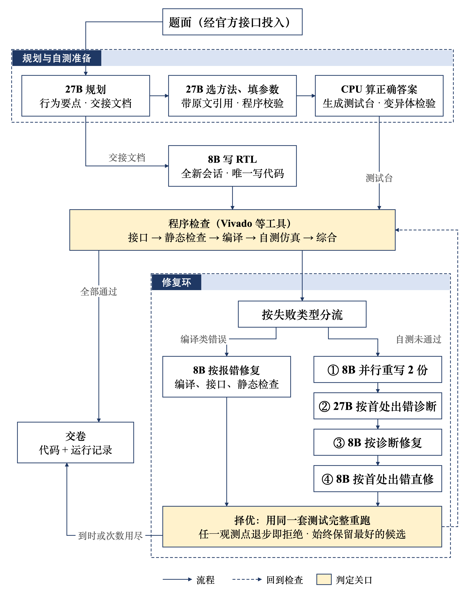

# 可验证RTL闭环设计智能体：设计报告

FPGA 创新设计大赛 · AMD RTL/HLS 本地智能体设计赛道（RTL）

---

## 摘要

RTL 设计是数字芯片与 FPGA 开发的核心环节。用大语言模型把自然语言描述直接转成 Verilog 代码，可以大幅缩短开发周期。但实际条件很苛刻：本地能部署的小模型推理深度不够，常常思考过长或理解出现偏差，无法生成正确的代码；此外赛题不提供参考测试台，智能体无法自行判断对错；同时，小模型修改代码时，容易在修正一处的同时引入新的错误。

本作品利用一张离线运行的显卡，搭建了一套受程序控制的 harness 智能体。系统由两个模型分工：27B 参数的辅助模型读题、规划、诊断失败，引用原题给出行为要点；8B 参数的主模型负责写代码，在全新的会话里只阅读一份精简的交接文档。智能体中还包含一套确定性自测：辅助模型从题面读出测试参数，由 CPU 计算期望值、由程序生成测试台，测试台经变异体检验后才用于判定。修复按失败类型分流，每份新代码都要在同一套测试上完整重跑。

在 AMD Radeon PRO W7900 上，我们对 VerilogEval v2 题集的 145 道有效题做了测试。使用与基线相同的 8B 模型，题集得分从 0.750 提升到 0.881，归一化增益 g = 0.525；无法编译的题从 25 道减到 2 道；开发期从未查看的 12 道保留题全部达到最高等级 L3；在同一批 60 道开发题上，得分也高于 27B 单模型智能体。所有题目均在 900 秒内完成，双模型同卡运行，显存峰值 31.18 GiB。

---

## 目录

- [摘要](#摘要)
- [1. 方案概述](#1-方案概述)
  - [1.1 什么是 harness](#11-什么是-harness)
- [2. 总体架构](#2-总体架构)
  - [2.1 Harness 的组成](#21-harness-的组成)
  - [2.3 方案是怎样一步步形成的](#23-方案是怎样一步步形成的)
- [3. 模型与推理栈](#3-模型与推理栈)
  - [3.2 选型过程：从一开始的构想到“27B 想、8B 写”](#32-选型过程从一开始的构想到27b-想8b-写)
- [4. 智能体设计](#4-智能体设计)
  - [4.2 重试与回退策略](#42-重试与回退策略)
  - [4.4 自我验证](#44-自我验证)
- [5. 技能包](#5-技能包)
- [6. 实测结果](#6-实测结果)
  - [6.5 结果分析](#65-结果分析)
- [7. 复现说明](#7-复现说明)
- [8. 失败分析](#8-失败分析)
  - [8.1 仍然做不出来的题目类型](#81-仍然做不出来的题目类型)
  - [8.2 尝试过但无效的改进](#82-尝试过但无效的改进)
- [9. 创新点总结](#9-创新点总结)
- [10. 结论与展望](#10-结论与展望)
  - [10.3 可复用性与应用前景](#103-可复用性与应用前景)
- [11. 参考文献](#11-参考文献)
- [12. 大模型协作记录](#12-大模型协作记录)
- [13. 附录](#13-附录)

> [!TIP]
> 第 1 节概述、第 2.1 节 harness 的组成、第 3.2 节选型过程、第 6.5 节结果分析、第 8.1 节失败分析为本次报告的重点，可以先行阅读。

---

## 1. 方案概述

> [!IMPORTANT]
> **好的 RTL 不一定来自更强的模型。** 我们用一个参数更少、但解码快约 7 倍的 8B 模型写代码，靠模型之外的 harness，获得一个强大的智能体，写出了比 27B 单模型方案更好的代码。

| 145 题全量测试 | 8B 裸跑（官方基线） | 8B + harness（本方案） |
| --- | ---: | ---: |
| 题集得分 | 0.750 | **0.881** |
| L3 可综合 | 106 题 | **124 题** |
| L0 无法编译 | 25 题 | **2 题** |
| 保留集（12 题，开发期从未查看） | 0.700 | **1.000**（12/12 题 L3） |
| 单题平均 / 最长用时 | 59 秒 / 244 秒 | 178 秒 / 799 秒（全部在 900 秒内） |

- **归一化增益 g = 0.525**：两列是同一个 8B、同一份量化、同一套思考设置，差别只在 harness。
- **超过 27B 单模型**：同一批 60 道开发题上，8B + harness 得分 **0.867**，27B 单模型 agent 为 0.853（第 3.2 节）。

### 1.1 什么是 harness

**智能体 = 模型 + harness** [17][18]。harness 是模型之外的全部：控制流、上下文管理、EDA 工具编排、确定性验证、修复与择优规则，以及时间与显存预算。

我们的 harness 有两个特点：

- **模型不变**：写代码的 8B 与官方基线是同一个模型，全部增益来自 harness。
- **受控调用**：模型不自由调用工具；下一步做什么，由程序根据编译、仿真与自测的证据决定。

| 角色 | 由谁担任 | 负责什么 |
| --- | --- | --- |
| **代码** | SiliconMind-V1-Qwen3-8B，Verilog 专项训练 [19]，基线同用 | 写首稿、并行重抽、按诊断修复 |
| **思考** | Qwen3.8-27B | **不写代码**；规划、为自测填写参数、失败诊断 |
| **判定** | 程序（CPU） | 算期望值、调用 Vivado、比较候选、分配 900 秒 |

这套分工是第一轮架构设计过程中萌生的想法，上云后经过实验对比验证才落地（第 3.2 节）；harness 的六个部件见第 2.1 节，各部件的来由与收益见第 4 节。

> [!TIP]
> **为什么选择这条路线**：
> harness 与技能包都不绝对依赖模型能力，比赛的重心是可复用，换上更强大的模型、提供更富足的算力后，这套智能体就能发挥更强的能力。（第 10.3 节）

### 1.2 设计目标

| 目标 | 做法 |
| --- | --- |
| **能力** | 8B 裸跑最主要的失分是“能编译但功能错”（L1），要尽可能推到 L3，所以自我验证是整个方案的重心 |
| **增益** | 基线与方案共用同一个 8B、同一份量化、同一套上下文与思考设置；开发期目标 g ≥ 0.6，即增益项的满分线 |
| **代价** | 每题 900 秒内必须交卷，超时也交出当前最好的候选；简单题两分钟内结束；不靠重复采样换分 |

<p align="right"><a href="#目录">↑ 返回目录</a></p>

---

## 2. 总体架构

<p align="center"></p>

一次解题的主线（控制器 `rtl-agent/src/dual/controller.mjs`）：

| 步骤 | 谁来做 | 做什么 |
| --- | --- | --- |
| ① 规划 | 27B | 写出带原文编号的行为要点，程序整理成给 8B 的 Markdown 交接文档 |
| ② 准备自测 | 27B → CPU | 27B 选检查方法、填参数并附原文引用；CPU 算激励与期望值，生成测试台；故意改错的变异体必须被测出来 |
| ③ 写代码 | 8B | 全新会话，只读交接文档，一次写出完整模块 |
| ④ 检查 | 程序 | 接口比对 → pyslang lint → Vivado 编译 → xsim 自测 → 综合；全部通过即交卷 |
| ⑤ 修复环 | 8B、27B | 编译类错误：8B 带诊断直接改。功能失配：8B 并行重抽 2 份 → 27B 读首个反例诊断 → 8B 按诊断修 → 8B 凭反例再修一次 |
| ⑥ 输出 | 程序 | `solution.v`（证据最好的完整候选）与 `trace.jsonl`（每次调用都可追溯） |

> [!NOTE]
> 回流给模型的只有编译错误、lint 结果和自测的**首个失配**；综合结果只用于把关。每个新候选都在与旧候选完全相同的激励下重放，任一原本正确的观测点变错即拒绝。

### 2.1 Harness 的组成

对照 harness 工程研究归纳的编程智能体子系统 [18]，本方案的六个部件各有对应，只是针对 RTL 与小模型做了取舍：

| 部件 | 对应的 harness 子系统 | 做什么 | 详见 |
| --- | --- | --- | --- |
| H1 上下文工程 | 上下文管理 | 27B 规划，8B 只读一份精简的交接文档，在全新会话中一次写完 | 4.3 |
| H2 验证工程 | 工具、约束 | 模型读题、CPU 算答案、变异体检验测试台，回应“参考测试台不下发” | 4.4 |
| H3 择优与回退 | 约束 | 相同激励完整重放，任一观测点退步即拒绝；始终持有最好的完整候选 | 4.2 |
| H4 修复路由 | 循环、编排 | 编译错误交 8B 机械修复；功能失配先由 27B 诊断，再由 8B 修复 | 4.2 |
| H5 并行重抽 | 编排 | 自测失败后，8B 两个槽并行重写 2 份，按自测证据择优 | 4.2 |
| H6 工具编排与时间预算 | 工具、编排 | Vivado 常驻进程，所有调用共享 900 秒，为最终验证预留时间 | 4.1 |

另有两项基础设施贯穿全局：`SKILL.md` 技能包（扩展，第 5 节）和逐调用记录的 `trace.jsonl`（可观测性）。

> [!NOTE]
> **与通用编程智能体的最大不同：程序掌控。** 模型不决定调用哪个工具、何时停止，这些都由控制器按证据决定。依据是实测：让 8B 独自承担理解、写代码与修复，增益为负（第 3.2 节）。这一思路与 Agentless 一致：由程序串起定位、修复、验证 [8]。

各部件的收益见第 6.5 节：20 道升到 L3 的题中，15 道由首稿直接取得（H1），5 道由修复环取得（H4、H5）。

### 2.2 设计依据

四条原则，每条都来自一次具体的教训：

1. **模型不能自己验证自己。** 让模型写测试台检查自己的代码，错误往往同时出现在两边。所以期望值交给 CPU 计算，再用变异体检验测试台确实能抓到错误。
2. **写代码的模型只做写代码这一件事。** 理解、拆解、诊断交给 27B；8B 每次只拿到一份交接文档，在全新会话中一次写完。
3. **宁可不改，也不改坏。** 修复必须有可行动的证据；新候选要在相同激励下完整重放，“失败总数变少”不足以被接受。
4. **一切改进都要能被关掉、能被对照。** 每个功能都有独立开关，配对实验证明有效后才进入正式配置（冻结在 `competition/serve/start.mjs` 的 `PRODUCTION_AGENT_ENV`）。

### 2.3 方案是怎样一步步形成的

> [!TIP]
> 方案分七个阶段形成，每一步都由上一步实测暴露的问题推动。每个阶段按“问题 → 做法 → 升级”记录，升级都附对照数据。

**阶段一 · 基础设施与工具层（9 月 22 日—10 月 15 日）**

- **问题**：已构想“大模型理解、小模型写代码”的分工，但本地只有一张 Radeon RX 7800 XT（16 GB），放不下两个模型，只能先做不依赖模型的部分。
- **做法**：先把“可验证”做扎实：技能包、接口检查、Vivado 工具链封装、每题隔离的工作目录、子进程监督与回收；自研 Vivado 持久化后端，与官方 MCP 对比。
- **升级**：修改 RTL 场景的中位耗时从官方后端的 123.46 秒降到 **109.95 秒**（3 个设计、48 次编译综合），故障恢复测试 3/3 通过。自研后端作为默认，官方后端可一键切换。

**阶段二 · 27B 单模型闭环（10 月 16 日—10 月 20 日）**

- **问题**：云端开放后，需要尽快有一个能跑通的完整方案，作为后续改进的对照基准。
- **做法**：用 Qwen3.8-27B Q6 一个模型完成理解、写代码与修复。
- **升级**：云端代表题 L3 从裸跑的 5/12 提升到 **7/12**；8 题 × 5 次采样，31/40 次 L3。
- **暴露的瓶颈**：解码约 9 token/s，留不出修复时间；理解与写代码争用同一段上下文；Q6 单独占 23.09 GiB 显存（第 3.2 节第一步）。

**阶段三 · 双模型分工落地（10 月 21 日—10 月 22 日）**

- **问题**：27B 写代码太慢，需要一个写得快、又懂 Verilog 的模型。
- **做法**：
  - 通过文献检索找到 Verilog 专项模型 SiliconMind-8B，用 60 题四组实验确认它“写得快、想不深”；
  - 架构落地为 **27B 理解与规划、8B 唯一写代码**，中间信息压缩成 Markdown 交接文档，每次调用开新会话；
  - 针对 8B 长思考挤占代码输出，加入分阶段输出控制。
- **升级**：
  - 8B 解码速度约为 27B 的 **7 倍**，同题写代码质量相当（4/8 对 4/8）；
  - 首个双模型版本 60 题 L3 **44/60**，同模型裸跑 36/60；
  - 两道长输出题上，8B 输出从 61,911 token 降到 28,149 token，总耗时从 1119 秒降到 704 秒。

**阶段四 · 从“模型写测试台”到“CPU 算期望值”（10 月 23 日—10 月 24 日）**

- **问题**：让模型自己写测试台，60 题中只有 12 题可用，而且错误常常同时出现在测试台和代码里。
- **做法**：改为“**27B 填结构化参数 + CPU 计算期望值 + 变异体负对照**”。
- **升级**：可执行自测从 12/60 提升到 **30/60**；6 道题的参考实现全部通过（此前 4/6），6 个预设错误全部检出。
- **未采用**：物理多模块生成与局部替换修复，5 题筛选 0/5 L3（旧流程 1/5）。

**阶段五 · 修复：“修对”比“修得多”重要（10 月 25 日—10 月 26 日）**

- **问题**：
  - 出现“失败总数从 6 降到 4，但原本正确的观测点被改坏”的候选；
  - 27B 诊断常常超时；
  - 8B 首稿随机性大：10 道历史失败题各重抽 5 次，7 道至少有一次 L3。
- **做法**：完整重放、任一观测点退步即拒绝；缩短诊断任务、最终轮只交结论；失败后 8B 两槽并行重抽 2 份，按自测证据择优。
- **升级**：
  - 3 份冻结错稿上，诊断超时从 3/3 降到 **0/3**，有效交接从 0/3 升到 3/3；
  - 48 题离线选稿实验，L3 从 35/48 提升到 **40/48**。

**阶段六 · 覆盖率扩展与正式接口（10 月 27 日—10 月 28 日）**

- **问题**：自测覆盖不够；双模型系统还没有经过官方提交入口；少数题输给基线。
- **做法**：
  - 四条实现线并行扩充自测方法库，用配对数据决定开关：状态表门禁、组合表达式、正文预留进入正式配置；
  - 适配官方提交形态（`serve/start.sh`、`/v1/solve`、`manifest.json`、`MODEL.md`）；
  - 逐题追查输给基线的题：修正对换行过严的引文校验，修复顺序改为“先 27B 诊断、后 8B 直修”。
- **升级**：
  - 通过官方接口完成 90 题配对测试，g = 0.568（剔除缺陷题后 82 题）；
  - 修复顺序调整后，14 道相关题 L3 从 5 题增至 6 题，总耗时下降 **31%**。
- **未采用**：多拍事务与新题型方法在目标题上 0 产出；预算调度在截断组 0/7 出卷。

**阶段七 · 定稿与全量测试（10 月 28 日—10 月 29 日）**

- **问题**：提交形态需要按官方 10 月 26 日的更新逐项核对；综合步骤存在浪费。
- **做法**：
  - 投题服务加守护进程，退出后 2 秒内自动重启；`Dockerfile` 固定赛事方 W7900 基础镜像；`MODEL.md` 写明各模型实测显存；
  - 去掉综合后从未被读取的时序报告；
  - 把接口比对、lint 规则、自测生成和踩坑记录打包成四项确定性技能（第 5.1 节）。
- **升级**：
  - 综合耗时下降 **42%**，42 份真实候选的判定前后完全一致；
  - 145 题全量测试 **g = 0.525**，L0 从 25 题降到 2 题，保留集 12/12 题 L3（第 6 节）。

### 2.4 工程方法

- **配对实验**：每项改动都与同一冻结题单上的对照组比较。题单用 SHA-256 固定，基线与方案在同一服务上先后运行。
- **保留集**：16 道题在整个开发期从未被查看或用于调参，只用于最终检验；剔除官方缺陷题后为 12 题（第 6.1 节）。
- **独立判定**：所有成绩由官方 `selftest/judge.py` 在智能体结束后判定；参考测试台与参考实现从不进入模型输入。
- **开关与冻结**：每个功能都有独立开关。对"关闭状态"建立了字节级黄金摘要测试，保证新代码在关闭时与旧行为逐字节一致。
- **回归**：核心 894 项、比赛入口 105 项自动化测试（封存版本）；官方 `baseline.py` 与 `run_baseline.sh` 逐字节校验未被改动。
- **可追溯**：每题保存交接文档、模型请求与响应、各版候选、工具日志和资源采样，trace 与实际 HTTP 请求做三方一致性校验。
- **单一 GPU 操作者**：云端所有测量都持有同一把 GPU 锁，保证测量互不干扰。

<p align="right"><a href="#目录">↑ 返回目录</a></p>

---

## 3. 模型与推理栈

### 3.1 最终选用的模型

方案共用三个本地开源权重，全部由 llama.cpp 加载在同一张 GPU 上。

| 模型 | 参数量 | 角色 | 量化 | 加载后显存 |
| --- | --- | --- | --- | --- |
| SiliconMind-V1-Qwen3-8B | 8B | 唯一写 RTL 的模型，基线同用 | GGUF Q6_K | 10.73 GiB |
| Qwen3.8-27B | 27B | 规划、自测参数、诊断，不写代码 | GGUF UD-Q4_K_M | 19.63 GiB（含草稿头） |
| Qwen3.8-27B-DSpark | 27B 的草稿头 | 只在 27B 进程内做投机解码加速 | GGUF Q4_K_M | 计入 27B 进程 |

| 运行配置 | 8B | 27B |
| --- | --- | --- |
| 端口与并发 | 127.0.0.1:8000，2 个槽（并行重抽） | 127.0.0.1:8001，1 个槽 |
| `max_model_len` | 32768（两槽共享，`--kv-unified`） | 20480 |
| 单次输出上限 | 智能体 12288；基线 16384（`baseline.py` 原样） | 6144（输出均为限长 JSON） |
| 思考 | 开启，预算 2048 token；与基线一致 | 开启，预算 2048 token |
| 采样（智能体） | temperature 1.0；top_p 0.95、top_k 40、min_p 0.05 | temperature 0.8、top_p 0.95；top_k 40、min_p 0.05 |
| 采样（基线） | temperature 0、top_p 1.0（`baseline.py` 原样） | 基线不使用 |
| RoPE 外推 | 无 | 无 |

- **合计显存**：加载后 30.40 GiB；145 题全量测试全程峰值 31.18 GiB（每 5 秒采样，共 6757 次）。
- **采样的取舍**：8B 用温度 1.0，让并行重抽得到真正不同的候选，再由自测证据择优；27B 的规划与参数要稳定，温度更低。请求中未设定的采样参数取 llama.cpp 服务端默认值。FAQ Q25 允许方案与基线采样不同，Q23 要求思考设置一致，两者都开启思考、预算相同。
- **8B 采样插件**：`third_party/llama-author-control` 只作用于带标记的智能体请求，基线请求不受影响（第 3.4 节）。

**权重来源、版本与校验和**（与 `model/MODEL.md`、`manifest.json` 一致）：

- **SiliconMind-V1-Qwen3-8B**：[thuniverse-ai/SiliconMind-V1-Qwen3-8B-GGUF](https://huggingface.co/thuniverse-ai/SiliconMind-V1-Qwen3-8B-GGUF)
  - revision `11a6c35ef3693c18c32bc82c30599de9a5d0a61e`
  - 文件 `SiliconMind-V1-Qwen3-8B-Q6_K.gguf`
  - sha256 `8c31e966b4cd1cff7d309513a571c7fff0cf5a9e4f8f277af1026635516b3921`
- **Qwen3.8-27B**：[unsloth/Qwen3.8-27B-GGUF](https://huggingface.co/unsloth/Qwen3.8-27B-GGUF)
  - revision `287999af67436bfaa4f4ee09dc34af328a495ba6`
  - 文件 `Qwen3.8-27B-UD-Q4_K_M.gguf`
  - sha256 `322e194ff79741c7baa497c240f677f54b201b0efab44ca8e50f122b39123482`
- **Qwen3.8-27B-DSpark**：[Anbeeld/Qwen3.8-27B-DSpark-GGUF](https://huggingface.co/Anbeeld/Qwen3.8-27B-DSpark-GGUF)
  - revision `77843de41a67edb1c6294d641ea38fa78f9c8124`
  - 文件 `Qwen3.8-27B-DSpark-Q4_K_M.gguf`
  - sha256 `02307a130d58ad478996c640753f2fe5f813f548c48e1881b7df56506ca7d545`

### 3.2 选型过程：从一开始的构想到“27B 想、8B 写”

> [!TIP]
> 大小模型分工是一开始就有的构想。上云后我们先用 27B 单模型跑通、摸清瓶颈，再用实验证明 8B 写得快却想不深，最后让两者分工，结果超过了 27B 单模型。

**起点（阶段一）：构想大小模型分工，但本地无法实测**

大模型理解力强但慢，小模型快但想不深；让大模型负责理解、小模型负责写代码，有望兼得速度与准度。但本地只有一张 Radeon RX 7800 XT（16 GB 显存），放不下两个模型同时运行，只能等云端开放再验证。

**第一步（阶段二）：先用 27B 单模型跑通闭环**

- **思路**：更强的模型应该写得更好；先跑通流程，也为后面的分工方案留一个对照基准。
- **结果**：代表题 L3 **7/12**，同模型裸跑 5/12；8 题 × 5 次采样，31/40 次 L3。
- **瓶颈**：解码约 9 token/s，一次写代码动辄几分钟，900 秒里留不出修复时间；理解与写代码争用同一段上下文；Q6 单独占 23.09 GiB 显存。

**第二步（阶段三）：找一个专门写 RTL 的小模型**

通过文献检索，我们从论文 [19] 中找到 SiliconMind-V1：基于 Qwen3-8B，用多智能体蒸馏得到的“生成—测试—调试”推理数据专门训练 Verilog 生成，并发布了可本地部署的权重。8 道题上同题对比“谁来写代码”：

| 写代码的模型 | L3 | 解码速度 | 8 题总生成时间 |
| --- | ---: | ---: | ---: |
| Qwen3.8-27B | 4/8 | 9.1 token/s | 2969 秒 |
| SiliconMind-8B | 4/8 | **67.7 token/s** | **1165 秒** |

单论写代码，两者质量相当，8B 快约 7 倍。

**第三步（阶段三）：8B 能不能单干？60 题四组配对实验**

把两个模型分别放进同一套单模型 agent 流程，在同一批 60 道开发题上各跑一遍：

| 同一套单模型流程，60 题 | 裸跑 | 加 agent | 归一化增益 g |
| --- | ---: | ---: | ---: |
| 27B Q4 | 0.753（43 题 L3） | 0.853（49 题 L3，0 题 L0） | +0.41 |
| 8B Q6 | 0.633（35 题 L3） | 0.523（30 题 L3，**23 题 L0**） | **−0.30** |

- 8B 一旦身兼数职就失控：23 道 L0 中有 22 道连完整代码都没交出来；
- 裸跑时 8B 因“题意理解错误”失败 7 题，27B 只有 2 题。

结论：8B 不能独自承担整个流程，需要更大的模型替它理解与诊断。

**第四步（阶段三起）：双模型分工——27B 想，8B 写**

- **做法**：27B 负责规划、自测参数与诊断，从不写代码；8B 只写代码，每次只读程序整理好的一份 Markdown 交接文档。
- **代价**：为了让两个模型同时放进 32 GB，27B 从 Q6 降到 UD-Q4_K_M；双模型实测峰值 31.28 GiB。
- **结果**：在第三步的同一批 60 道题上：

| 同一批 60 道开发题 | L3 | L1 | L0 | 题集得分 | 单题平均用时 |
| --- | ---: | ---: | ---: | ---: | ---: |
| 8B 单模型 agent | 30 | 7 | 23 | 0.523 | 152 秒 |
| 27B 单模型 agent | 49 | 11 | 0 | 0.853 | 130 秒 |
| **8B + 27B 双模型 harness（最终版本）** | **50** | **10** | **0** | **0.867** | 213 秒 |

> [!NOTE]
> 前两行来自第三步的开发期实验，第三行取自封存版本 145 题全量测试中的同一批 60 题，都由云端 Vivado 与官方判定器判分。两次实验的流程版本不同，比较的是“当时最好的单模型方案”与“最终方案”。

**27B 单模型更快，为什么不选它？**

- **它快，是因为几乎不修复**：第三步实验中，它进入修复的 9 道题里，功能错误被修到 L3 的是 **0** 道。
- **双模型把省下的时间用在了修复上**：8B 生成平均每题 86 秒，其中 49 秒用于首稿之后的重抽与修复；修复环最终救回 11 道题（第 6.5 节）。
- **反过来让 27B 写代码会超时**：按解码速度粗估，同样的流程平均每题约需 731 秒，约 24 道题会超出 900 秒时限。

> [!IMPORTANT]
> **这次选型的意义**：最终方案的能力不是靠更强的写代码模型得来的。写代码的是更小、更快的 8B，好结果来自 harness。所以方案不绑定模型，换上更强的代码模型，harness 与技能可以直接复用。

**评估过并放弃的候选**

| 候选 | 放弃原因 |
| --- | --- |
| 27B Q6 单模型（理解、写代码、修复全包） | 解码约 9 token/s，留不出修复时间；单独占 23.09 GiB 显存 |
| 27B Q4 单模型 agent | 60 题 0.853，低于双模型的 0.867；功能错误修复 0 题 |
| 8B 单模型 agent | g = −0.30，60 题中 23 题 L0 |
| 27B 作为写代码的模型 | 与 8B 同为 4/8，但速度只有约 1/7（2969 秒对 1165 秒） |
| 27B 用 Q6 作为辅助模型 | 双模型配置峰值已达 31.28 GiB，换 Q6 会超出 32 GB |
| KV 缓存 q8_0 量化 | 8 题配对：f16 为 5/8 L3，q8_0 为 4/8；生成时间 36.5 秒对 40.9 秒 |
| vLLM 后端 | GGUF 量化与 DSpark 投机解码都依赖 llama.cpp；正式入口对其他后端直接报错退出 |

### 3.3 是否微调

否。两个模型（及 27B 的 DSpark 草稿模型）均直接使用公开发布的权重。

### 3.4 推理栈

| 项           | 内容                 |
| ------------ | -------------------- |
| 推理后端     | llama.cpp `llama-server`（镜像 `/opt/llamacpp`，build f114f91） |
| 版本         | 二进制 sha256 `290708d22f8b495d36b8aedd0afb0cdc081c415548f855e6a950a75dd742ad97` |
| 关键启动参数 | 共同：`--n-gpu-layers 999 --split-mode none --jinja --reasoning on --reasoning-budget 2048`；8B：`--ctx-size 32768 --parallel 2 --kv-unified`；27B：`--ctx-size 20480 --parallel 1 --spec-type draft-dspark --spec-draft-n-max 7` |
| 并发策略     | 两个常驻进程：8B 在 127.0.0.1:8000（两个槽，用于并行重抽），27B 在 127.0.0.1:8001；投题服务 127.0.0.1:7860 串行处理请求 |

选择 llama.cpp 的原因：
- GGUF 量化让两个模型在 32 GB 内共存；
- DSpark 投机解码加速 27B 的长 JSON 输出；
- 镜像自带二进制，断网环境不需要额外安装。

**调度策略由实测决定**（10 月 26 日单卡调度测量）：

| 测量 | 结果 | 采用的策略 |
| --- | --- | --- |
| 27B 与 8B 同时推理 vs 依次推理 | 同时推理总体慢 24%；27B 从约 32 token/s 降到约 10 token/s | 两个模型之间严格串行 |
| 8B 单服务同时处理 2 个请求（`--parallel 2`） | 总吞吐约为单请求的 1.6 倍 | 自测失败后两份重抽候选并行生成，省下一次 8B 写代码的等待 |
| 并行与串行重抽的离线回放 | 救回的题数相同 | 并发只节省时间，不改变结果 |
| 27B + DSpark 草稿模型投机解码 | 自测参数请求 31 → 54～58 token/s；规划请求 32 → 41～45 token/s；投机解码由主模型逐 token 验证，不改变输出分布 | 默认开启 |
| n-gram 投机解码 | 27B 无变化（约 32 token/s）；8B 仅提升约 5～10% | 不采用 |

所有步骤共享每题 900 秒期限，并为最终验证预留时间；145 题最长一题 799 秒，无一超时。

8B 进程额外预加载一个自研采样插件（`third_party/llama-author-control`）：
- 只作用于带标记的智能体请求，基线请求不受影响；
- 识别 8B 输出所处的阶段（分析 / 代码）：在分析段启用 DRY 重复惩罚，输出过长时给一次收束提示，代码段不干预；
- 后端版本不符时自动不加载。

ROCm 相关经验：
- 旧版 llama.cpp（b8407 / ROCm 7.2.1）加载模型时报 `missing MTP tensor`，较新版本路径可用；
- Windows 本地开发需要匹配的 ROCm core/math/device 运行库。


<p align="right"><a href="#目录">↑ 返回目录</a></p>

---

## 4. 智能体设计

> [!TIP]
> **一句话**：本节是 harness 六个部件（第 2.1 节 H1–H6）的实现细节。每个小节末尾的“设计来由”回答三个问题：为什么这样设计、借鉴了谁、实测带来多少收益。

借鉴均在方法层面，代码独立实现（第 11 节）。

### 4.1 控制流

一次解题（`mode=agent`）：

1. **接收**：读取 `prompt.txt`，从题面解析模块名与端口表（评测题集的 `interface` 为空串），建立 900 秒总预算和本题的隔离工作目录。
2. **27B 规划**：输出短 JSON——难度、时序风险、带原文编号的行为要点、是否拆分。程序校验每条引文确实出自题面，然后生成给 8B 的 Markdown 交接文档。
3. **27B 准备自测**：从方法库中选择适用的检查方法并填写参数。程序依次完成：
   - 校验参数：端口存在、位宽一致、引文可在题面中找到；
   - 由 CPU 计算激励与期望值，生成测试台；
   - 用变异体跑一遍，**变异体必须失败**，测试台才被采用。

   没有适用方法时如实标记"无自测"。
4. **8B 写代码**：全新会话，只读交接文档和不超过两条相关技能摘要，一次写出完整模块。
5. **检查**：接口比对 → pyslang lint → Vivado 编译 → 自测仿真 → 综合。
6. **退出**：全部通过即交卷；否则进入 4.2 的重试流程，直到通过、次数用尽或时间到达。无论何时退出，`solution.v` 都是当前证据最好的完整候选。

每一次模型调用、工具调用和候选版本都写入 `trace.jsonl`，带运行编号、请求编号和候选哈希，可以从投题完整复盘到交卷。

#### 设计来由：H6 工具编排与时间预算
- **怎么想到的**：900 秒里，模型生成之外最耗时的是 Vivado。耗时分析显示每次综合约 36 秒，其中约 14 秒在生成一份从未被读取的时序报告；反复冷启动 Vivado 也在浪费时间。
- **借鉴**：以官方 Vivado MCP 为对照，测量后自研持久化后端；超时也要交出最好候选的做法，与 harness 工程中“运行时对预算负责”的思路一致 [18]。
- **收益**：修改 RTL 场景的中位耗时 109.95 秒，官方后端为 123.46 秒；去掉时序报告后综合耗时下降 42%，42 份真实候选的判定不变；145 题无一超时，单题中位 120 秒。

### 4.2 重试与回退策略

| 阶段 | 触发 | 做法 | 上限 |
| --- | --- | --- | --- |
| 编译 / 接口修复 | 编译失败或接口不符 | 8B 带编译器诊断修改 | 计入共享的 8B 尝试次数 |
| lint 修复 | pyslang 报多驱动等问题 | 8B 只修 lint 指出的问题 | 同上 |
| 并行重抽 | 自测失败 | 8B 两个槽并行再写 2 份候选，按自测证据择优 | 1 轮 |
| 诊断修复 | 重抽后仍失败 | 27B 读首个反例与代码，给出问题与修复目标；8B 带诊断和反例修复 | 1 次诊断 |
| 反例直修 | 诊断修复后仍失败，或诊断不可用 | 8B 只带反例再修一次 | 1 次 |

- **次数**：初稿之后 8B 最多 4 次修复调用，27B 诊断最多 1 次。
- **时间**：
  - 所有调用共享 900 秒截止时间，修复阶段为最终验证预留 90 秒；
  - 若剩余时间放不下"27B 诊断 + 一次 8B 修复 + 验证"，跳过诊断，直接做反例直修；
  - 预留的修复时间按本题上一次 8B 写代码的实测耗时估算，而不是按上限估算。
- **择优**：新候选在与旧候选完全相同的激励下完整重放。任一原本正确的观测点变错即拒绝；只接受严格改进或部分改进。

**修复顺序是由数据决定的。** 10 月 28 日之前顺序是"先 8B 反例直修，失败再 27B 诊断"。90 题实测中，进入修复的 12 道难题：
- 反例直修只修好 1 道，平均每次约 140 秒；
- 27B 诊断后的修复，在实际运行的 7 道中修好 3 道；
- 另有 3 道题因为直修耗时过长，没来得及诊断。

因此改为"先诊断、后直修"（`AGENT_REPAIR_DIAGNOSIS_FIRST`）。在 14 道相关题上复测：

| 项 | 调整前 | 调整后 |
| --- | ---: | ---: |
| L3 题数 | 5 | 6 |
| 系数合计 | 6.8 | 7.6 |
| 总耗时 | 8152 秒 | 5628 秒（−31%） |

- 新增 L3：Prob096、Prob137；
- 原本 L3 的 4 题全部保持，而且都更快，如 Prob124 从 676 秒降到 190 秒；
- 退回 L1 的 Prob154 并非新顺序所致：该次重抽被截断、耗时过长，诊断因时间预算被跳过，走的仍是旧路径。

#### 设计来由：H4 修复路由
- **怎么想到的**：编译错误有明确的行号和原因，8B 机械修改就够了；功能失配则需要理解“为什么错”，这正是 8B 的短板（第 3.2 节第三步）。实测也印证了这一点：8B 拿到反例倾向于局部打补丁，直修 12 道难题只修好 1 道。
- **借鉴**：RTLFixer 让编译错误走短反馈路径 [7]；VerilogCoder 从失配信号追溯到源代码 [2]；RepairAgent 由中间层整理证据、每次只给模型一个有限任务 [9]。
- **收益**：诊断后修复 3/7，直修 1/12；改为先诊断后，14 道相关题 L3 从 5 题增至 6 题、总耗时下降 31%。全量测试中修复环直接带来 5 道 L3 增益和 6 道 L0 → L1。

#### 设计来由：H5 并行重抽
- **怎么想到的**：8B 首稿的随机性很大，10 道历史失败题各重抽 5 次，7 道至少有一次 L3。官方按 pass@1 计分，与其赌一次，不如让自测替我们挑；8B 够快，才负担得起多写几份。
- **借鉴**：Agentless 生成多个候选、用测试选出最好的一个 [8]。
- **收益**：48 题离线选稿实验中 L3 从 35 题提升到 40 题；全量测试中有 4 题最终交的是重抽候选。两份候选并行生成，比串行少等一次 8B 写代码的时间。

#### 设计来由：H3 择优与回退
- **怎么想到的**：实测中出现过“失败总数从 6 降到 4，但原本正确的观测点被改坏”的候选。若按失败数择优，它会被接受。
- **借鉴**：Agentless 把定位、修复、验证分阶段，并用回归测试筛选补丁 [8]；RTL-Repair 限定修改范围、对完整轨迹做回归 [6]。我们没有采用 Agentless “回归失败最少”的选稿方式，而是更严格：任一观测点退步即拒绝。
- **收益**：全量测试中，这条规则在 8 道题上拒绝了 13 个“修好一处、改坏另一处”的候选（重抽阶段 8 个、修复阶段 5 个），其中 Prob111、Prob152、Prob154 最终保持 L3，后两题的基线是 L0。

### 4.3 上下文管理

- **不累积聊天历史**：每次 8B 调用都是全新会话。输入是程序生成的交接文档：原题、接口、27B 的行为要点、当前代码、本次要修的证据；不带旧对话，也不带模型的思考内容。
- **工具输出压缩**：
  - Vivado 日志只提取错误行与对应的源码位置；
  - 自测结果只回灌**首个失配**，以及此前最近一拍正确的观测（输入、实际值、期望值、对应的题面依据），不回灌整张波形表。
- **输出预算**：8B 输出上限 12288，思考预算 2048；采样插件在分析段落做重复惩罚和一次收束提示，防止长思考把代码挤出输出窗口。27B 的计划与参数都是限长 JSON。
- **截断处理**：输出被截断或格式无效时记录错误码，残缺代码不会被当作候选。

#### 设计来由：H1 上下文工程
- **怎么想到的**：8B 的短板是想不深，长上下文会放大这个短板。基线里同一个 8B 有 20 道题思考超出 16,384 token 上限、一行代码都没写出来；在单模型流程里，它更是 22 道题交不出完整代码（第 3.2 节）。所以要让 8B 少想、只写：理解交给 27B，8B 拿到的是一份已经想清楚的交接文档。
- **借鉴**：VerilogCoder 的“先规划、再按局部上下文生成” [2]；RepairAgent 由中间层整理状态与证据、每次只给模型一个有限任务 [9]。用上下文工程决定“模型该看到什么”，正是 harness 工程的组成部分 [17][18]。
- **收益**：两道长输出题上 8B 输出从 61,911 token 降到 28,149 token、总耗时从 1119 秒降到 704 秒；全量测试中 20 道 L3 增益有 15 道由首稿直接取得，L0 从基线的 25 题降到 2 题。

### 4.4 自我验证

参考测试台不下发。本方案的回答是：**让模型读题，让 CPU 算答案，再让变异体检验测试台本身。**

- 27B 从题面读出结构化参数，例如：
  - 状态转移表；
  - 序列 `1101` 是否可重叠，输出是脉冲还是保持；
  - 计数的上下限；
  - 组合表达式。

  每个参数都要附题面原文引用，程序核对引文确实出自题面。
- CPU 按参数计算激励与期望值，生成 SystemVerilog 测试台在 xsim 中运行。激励覆盖复位、边界、连续触发和随机段。
- **负对照**：对正确行为构造变异体（改错一个转移、反转一个极性等），测试台必须让变异体失败，否则判为无效，不用于评判候选。
- 方法库覆盖：组合逻辑（含表达式与卡诺图）、寄存器、移位、计数器、Moore/Mealy 状态表、序列检测、波形表等。

#### 设计来由：H2 验证工程
- **怎么想到的**：参考测试台不下发，是本赛道的核心考点。最初让模型自己写测试台，60 题中只有 12 题可用，而且错误常常同时出现在测试台和代码里：模型不能自己验证自己。
- **借鉴**：PAL 的“模型负责理解、程序负责计算” [10]；nl2spec 把每条规格绑定到原文片段 [1]；AutoBench / CorrectBench 把规格、场景、检查器分开，并假设检查器本身也会出错、用正反对照检验 [4][5]；cocotb 把驱动与采样分相 [15]。
- **收益**：可执行测试台从 12/60 提升到 30/60，6 道题的参考实现全部通过、6 个预设错误全部检出；全量测试 113/145 题建立了自测，有自测的题未达 L3 的比例为 10%，没有自测的为 31%。

> [!WARNING]
> **这个选择的代价**
> 1. 145 题中有 32 题没能建立自测（参数校验失败、输出被截断或没有适用方法，见第 8.1 节），这些题只能依靠编译与综合检查。
> 2. 测试台只覆盖题面读得出的行为，出现过“自测通过、官方判 L1”的情况（第 8.1 节）。
> 3. 准备自测要额外调用 27B，单题约 30～40 秒。

<p align="right"><a href="#目录">↑ 返回目录</a></p>

---

## 5. 技能包

> [!TIP]
> **一句话**：6 项提示词技能告诉 8B 怎么写，4 项确定性技能用程序检查写得对不对；两类技能都不依赖本方案的模型，可以单独复用。

### 5.1 技能清单

技能包位于 `skill/`，采用 AMD `SKILL.md` 格式。每个技能包含规则、可在目标器件上综合的自写示例和来源说明；`index.json` 给出选择关键词。技能中不含任何题目答案。

| 技能名称 | 解决什么问题 | 适用条件 | 不适用 |
| -------- | ------------ | -------- | ---------------- |
| `sv-combinational` | 组合输出默认值、多路选择优先级、避免锁存器 | 组合逻辑 | 时钟驱动的行为 |
| `sv-sequential` | 复位极性与同步性、使能、流水延迟、数据与 valid 对齐 | 时序逻辑 | 纯组合逻辑 |
| `sv-fsm` | 转移表、Moore/Mealy 输出时刻、可重叠序列检测 | 状态机 | 数据通路运算 |
| `sv-fifo` | 满/空、同时读写、指针回绕 | 队列与缓冲 | 单个寄存器 |
| `sv-width-sign` | 位宽、符号扩展、移位与截断 | 算术 | 控制逻辑 |
| `vivado-sv` | Vivado 2026.1 能接受的 SystemVerilog 写法 | 所有题 | 工具选择与时序收敛 |

**使用方式**：每题按关键词自动选择不超过两项技能，以不超过 3000 字符的摘要作为 `Advisory rules` 拼入 8B 的提示词。技能是条件性建议，原始题面始终优先；选择过程不额外调用模型。

**技能包之外，同样可复用的确定性资产**：
- 接口比对：`competition/agent/interface.mjs`；
- pyslang lint 规则；
- 自测方法库与参数校验：`rtl-agent/src/verification/`；
- 修复路由与择优规则：`rtl-agent/src/dual/repair-routing.mjs`。

这些模块不依赖本方案的模型，可以直接嵌入其他 RTL 智能体。为了让他人能直接复用，我们把其中四项打包成**确定性技能**（同样位于 `skill/`，每项带 `SKILL.md`、命令行脚本和带期望输出的示例；智能体的程序代码直接调用同一份实现，不把它们作为提示词）：

| 技能名称 | 解决什么问题 | 适用条件 | 不适用 |
| -------- | ------------ | -------- | ---------------- |
| `spec-selftest` | 把带题面引文的方法参数编译成 CPU 期望值、测试台和负对照，可选直接仿真 | 题面能读出结构化行为（状态表、计数、序列、组合表达式等） | 完整的正确性证明；题面没有的行为 |
| `rtl-interface-check` | 在跑 Vivado 前比对端口名、方向与位宽 | 任何给出端口表的题 | 功能验证 |
| `rtl-lint-rules` | 定位智能体使用的六条 pyslang 规则（多驱动、符号等） | 跑 Vivado 前的快速检查 | 替代 Vivado；缺少 pyslang 时跳过 |
| `rtl-pitfalls` | 查询十条有运行证据支撑的踩坑记录（题号、提交、计数） | 改设计或改检查器之前 | 没有运行证据的一般建议 |

### 5.2 提炼过程

六项技能在项目启动时（9 月 22 日）由 RTL 设计中常见的错误类别整理而成，对应"组合 / 时序 / 状态机 / 缓冲 / 位宽符号 / 工具兼容"六类。开发期的失败样本主要沉淀进了确定性检查，而不是继续扩写技能文本：

- **Vivado 不接受的写法与多驱动** → pyslang lint 规则与 `vivado-sv`；
- **Moore/Mealy 输出差一拍、序列重叠判断错误** → `sv-fsm`，以及自测方法库中的 `mealy_table` 与 `sequence_detector_v2`；
- **复位优先级、同拍更新** → `sv-sequential`，以及寄存器 / 计数器类检查方法。

### 5.3 有效性验证

我们没有单独做"开 / 关技能"的消融实验。技能以"建议规则"形式常开，其效果包含在整体方案与基线的对照中（第 6 节）。

可量化的是技能之外的确定性检查：结构化自测把可执行测试台从 12/60 提升到 30/60（第 2.3 节阶段四）。

**技能与模型解耦。** 提示词技能按 `SKILL.md` 格式组织，确定性技能是可独立运行的脚本，两者都不依赖本方案所用的模型。更换写代码的模型时，只需重新校准输出格式与长度控制（第 8.3 节），技能与 harness 的其余部分可以直接复用。

<p align="right"><a href="#目录">↑ 返回目录</a></p>

---

## 6. 实测结果

> [!TIP]
> **一句话**：145 题上方案 0.881、同模型基线 0.750，g = 0.525；无法编译的题从 25 道降到 2 道；保留集 12/12 题 L3。

### 6.1 测试环境

- **数据集**：VerilogEval v2 `dataset_spec-to-rtl`，用官方 `selftest/veval_import.py` 转换。全部 156 题剔除官方 `selftest/README.md` 公布的 11 道缺陷题（Prob034、053、062、078、082、093、099、104、141、149、156），共 **145 题**。按开发期是否接触过分为三组：
  - 保留集 12 题：开发全程未查看、未调参（原 16 题中 4 题属于缺陷题）；
  - 开发集 54 题：开发期调参用过的题；
  - 其余公开题 79 题。

  每题再按结构特征（时序、状态寄存器、case、符号运算、位宽、输出数）分为简单 / 中等 / 困难三档。分组与分档只用题目元数据，不看结果。
- **被测版本**：封存提交 17f3fdb 的导出包（`source_dirty: false`），与提交仓库内容一致。
- **采样次数**：每题方案、基线各 1 次。
- **入口**：完全按官方方式。`serve/start.sh` 启动服务，经 `/v1/solve` 投题（每题先方案后基线），每 2 秒轮询 `/v1/jobs/<id>`，每题 900 秒。
- **时间**：2026-10-28 22:14 至 10-29 07:54（北京时间），共约 9 小时 40 分钟，含判分。
- **硬件**：Radeon Cloud，AMD Radeon PRO W7900。显存按 32 GB 预算使用，全程每 5 秒采样一次。
- **判定**：官方 `selftest/judge.py`，Vivado 2026.1，`xczu3eg-sbva484-1-e`，5 ns。

### 6.2 分级结果：方案与基线对比

| 级别               | 方案题数 | 基线题数 | 系数 |
| ------------------ | -------: | -------: | ---: |
| L0 未通过          | 2 | 25 |    0 |
| L1 可编译          | 19 | 14 |  0.2 |
| L2 仿真通过        | 0 | 0 |  0.7 |
| L3 可综合          | 124 | 106 |  1.0 |
| **题集得分** | **0.881** | **0.750** |      |

```
归一化增益 g = (0.881 − 0.750) / (1 − 0.750) = 0.525
```

按分组：

| 分组 | 题数 | 方案 | 基线 | g |
| --- | ---: | ---: | ---: | ---: |
| **保留集（从未调参）** | 12 | **1.000** | 0.700 | **1.000** |
| 开发集 | 54 | 0.852 | 0.652 | 0.574 |
| 其余公开题 | 79 | 0.884 | 0.825 | 0.333 |
| 保留集 + 其余公开题 | 91 | 0.899 | 0.809 | 0.471 |

按难度：

| 难度 | 题数 | 方案 | 基线 | 方案领先 | g |
| --- | ---: | ---: | ---: | ---: | ---: |
| 简单 | 55 | 0.938 | 0.829 | +0.109 | 0.638 |
| 中等 | 31 | 0.948 | 0.884 | +0.064 | 0.556 |
| 困难 | 59 | 0.793 | 0.607 | **+0.186** | 0.474 |

困难题上方案领先的绝对幅度最大；但困难题的基线也最低，剩余差距大，归一化后的 g 反而低于简单题。

与此前的 90 题抽样（10 月 28 日，剔除缺陷题后 82 题，g = 0.568）相比，全量结果多纳入了 63 道题，其中“其余公开题”占多数，而这一组正是方案增益最低的一组（第 6.5 节）。

### 6.3 pass@1 与 pass@5

| 指标   | 方案 | 基线 |
| ------ | ---: | ---: |
| pass@1 | 0.881（145 题单样本） | 0.750（145 题单样本） |
| pass@5 | 未测量 | 未测量 |

全量测试每题只采样 1 次。单次结果有波动，10 月 29 日对两道题的重跑可以说明：

| 题目 | 全量测试 | 重跑 | 说明 |
| --- | --- | --- | --- |
| Prob068_countbcd 方案 | L1 | L3 | 两次都没有建立功能自测，对错取决于这一次 27B 与 8B 对使能信号的理解（第 8.1 节） |
| Prob068_countbcd 基线 | L3 | L3 | 两次生成的代码逐字节相同 |
| Prob145_circuit8 方案 | L0 | L1 | 两次都没做对 |
| Prob145_circuit8 基线 | L3 | L0 | 全量测试中思考 14,182 token 后在 16,384 的上限前写出代码；重跑时思考超出上限被截断 |

- **方案**：8B 写代码的温度为 1.0，27B 规划同样带随机性，每次的理解与写法都可能不同。
- **基线**：`baseline.py` 固定温度 0，短输出基本可复现；但思考链很长时，GPU 并行计算的微小数值差异会逐步累积，结果可能完全不同。
- **影响**：一题在 L3 与 L1 之间变化一次，题集得分变化约 0.0055，g 变化约 0.02。正式评测每题 5 次采样，按平均计分，我们的单次 g = 0.525 应理解为带有约 ±0.04 误差的估计。

开发期的多样本数据：
- 10 道历史失败题各重抽 5 次首稿，7 道至少一次 L3，单题成功次数从 1/5 到 5/5 不等；
- 早期单模型方案 8 题 × 5 次采样，Agent 31/40 次 L3。

8B 首稿的随机性很大，这正是“失败后并行重抽 + 证据择优”的设计依据：把 pass@k 的潜力通过自测证据转化为 pass@1。

### 6.4 墙钟

| 项           | 方案 | 基线 |
| ------------ | ------ | ------ |
| 单题平均     | 178 秒（中位 120 秒，p90 330 秒） | 59 秒（中位 20 秒，p90 222 秒） |
| 单题最长     | 799 秒（无一题触及 900 秒） | 244 秒 |
| 全题集总时长 | 7.19 小时 / 145 题 | 2.37 小时 / 145 题 |
| 测量所用硬件 | Radeon PRO W7900 | 同左 |

服务冷启动（权重校验、两个模型加载、投题服务就绪）约 100～105 秒；显存全程峰值 31.18 GiB。超过 600 秒的 9 题都是困难题（多条件状态机、串行协议、波形反推、分支预测），其中 7 题最终未达 L3（第 8.1 节）。

### 6.5 结果分析

**增益的来源**：方案胜过基线 34 题，输给基线 2 题，其余 109 题持平。逐题追溯最终交卷的代码由 harness 哪一环产出：

| 基线 → 方案 | 首稿即达到（H1：规划 + 交接文档 + 输出控制） | 由修复环产出（H4、H5） | 合计 |
| --- | ---: | ---: | ---: |
| L0 → L3 | 8 | 2 | 10 |
| L1 → L3 | 7 | 3 | 10 |
| L0 → L1 | 8 | 6 | 14 |
| L3 → L1 / L0（退步） | — | — | 1 / 1 |

1. **无法编译的题从 25 道降到 2 道，这是增益的最大来源，主要来自上下文工程。** 基线的 25 道 L0 中，**20 道是思考超过 16,384 token 的输出上限、没有写出代码**（`finish = length`），其余 5 道是写出的代码编译不过。方案中 8B 每次只读一份精简的交接文档，输出受思考预算与分阶段输出控制约束（第 4.3 节），编译错误又能经编译器反馈修复，并且始终保留当前最好的完整候选，因此几乎不会交出不可编译的代码。
2. **首稿本身就写得更对。** 10 道 L1 → L3 中有 7 道是首稿直接写对：27B 先把题意整理成带原文引用的行为要点，8B 照着写，自测通过后程序及时停下。另外 3 道靠修复环，例如：
   - Prob063_review2015_shiftcount：基线 L1；方案首稿未通过自测，两份重抽候选也未通过，27B 诊断后 8B 修改，L3（290 秒）；
   - Prob043_vector5、Prob112_always_case2：基线 L1，方案各经 2 次修正后 L3。
3. **修复环救回 11 题。** 首稿未通过检查、最终修到 L3 的有 11 题，其中 5 题基线未达 L3；择优规则同时拒绝了 13 个退步候选（第 4.2 节）。
4. **8B 的速度换来了修复的空间。** 8B 生成合计平均每题 86 秒，其中 49 秒用于首稿之后的重抽与修复。按解码速度粗估，同样的流程若由 27B 写代码，平均每题约 731 秒，约 24 道题会超出 900 秒时限（第 3.2 节）。
5. **保留集 12/12 题 L3。** 这组题开发期从未查看，是对泛化能力最干净的检验；与 90 题抽样时的结论一致。
6. **其余公开题增益较低（g = 0.333）。** 这一组基线已有 0.825，方案的失分集中在拿不到功能自测的题和多条件状态机（第 8.1 节）。
7. **输给基线的 2 题**都已归因（第 8.1 节）：
   - Prob068_countbcd：27B 对使能信号的理解有偏差，并因此放弃了本来正确的自测方法，方案在没有功能自测的情况下交卷；
   - Prob145_circuit8：修复补丁两次被判超出允许范围而拒绝，到 600 秒时交回第一版，而第一版接口检查未通过，官方判为无法编译。

<p align="right"><a href="#目录">↑ 返回目录</a></p>

---

## 7. 复现说明

### 7.1 构建

```bash
docker build -t rtlagent .
```

`Dockerfile` 默认基于赛事方 W7900 基础镜像的固定哈希（`fpgachina-rtlhls@sha256:a7cf627e…`），安装锁定的 Node 依赖（`npm ci --omit=dev`）和离线 pyslang wheel，并显式使用镜像中的 `/opt/python`（Python 3.14），运行时不联网。

### 7.2 启动推理服务

```bash
# 权重按 model/MODEL.md 的地址与 revision 下载，放在 /workspace/models
# （或设置 MAIN_MODEL_PATH、AUX_MODEL_PATH、DRAFT_MODEL_PATH）
source /workspace/env.sh               # 实例自带：Vivado 许可证与路径
export FPGACHINA_TOKEN=<投题令牌>
bash serve/start.sh                    # 幂等；三个常驻进程以 setsid 启动，就绪后返回 0
```

`serve/start.sh` 会依次：
- 校验权重的大小与 SHA-256；
- 写入冻结的智能体配置（`PRODUCTION_AGENT_ENV`）；
- 检查服务就绪与显存；
- 把状态写入 `$SERVICE_STATE_DIR`（默认 `/var/tmp/rtl-agent-service`）。

投题服务由守护进程（`competition/serve/api-supervisor.mjs`）拉起：服务进程退出后 2 秒内自动重启，与官方示例的 `serve/run_api.sh` 一致；进程清理无法确认时，服务主动退出并由守护进程换新。云端实测强制结束服务进程后 26 秒恢复应答，短于平台约 60 秒收回隧道的时限。

对外只经 `rc-tunnel` 暴露 7860。

### 7.3 单题运行与基线运行

```bash
./run.sh <input_dir> <output_dir>            # 产出 solution.v 与 trace.jsonl
./run_baseline.sh <input_dir> <output_dir>   # 基线，同一推理服务
```

### 7.4 自测复现

- 环境自检通过：[x] 是 [ ] 否
- 参考实现判到满级：[x] 是。云端用官方判定器检验三道示例题的参考实现，均为 L3、零失配。
- 报告中的分级结果可复现：[x] 是。评测驱动在开发仓库 `evaluation/official_api/`（`session.sh` 启动服务并持有 GPU 锁，`drive.py` 按题单投题并调用官方判定器），按 6.1 的 145 题题单重跑。方案带随机性，单题等级可能与本报告不同（第 6.3 节）。

### 7.5 已知的环境依赖

- 权重目录 `/workspace/models`，约 24 GB，不在仓库中。
- Vivado 许可证与路径来自实例的 `/workspace/env.sh`；`start.sh` 不覆盖调用方环境。
- Node.js 24：`start.sh` 依次查找 `NODE_BIN`、`PATH`、`/usr/local/bin/node`。
- Vivado 工作目录放在节点本地盘（`/var/tmp`），不要放在网络存储上。每个请求使用独立工作目录，结束后清理。
- 两项可选组件在缺失时自动降级，都不影响出卷：
  - pyslang 不可用时，lint 自动关闭；
  - 8B 采样插件编译失败时，自动不加载。

<p align="right"><a href="#目录">↑ 返回目录</a></p>

---

## 8. 失败分析

> [!TIP]
> **一句话**：21 题未达 L3。最主要的短板是自测覆盖：有自测的题失败率 10%，没有自测的题失败率 31%。

### 8.1 仍然做不出来的题目类型

方案在 145 题中有 21 题未达 L3（L1 19 题、L0 2 题）。逐题读 trace 后，按“系统在哪一环没能拦住错误”分为四类：

| 类别 | 题数 | 代表题 | 原因 |
| --- | ---: | --- | --- |
| **没有功能自测，没发现失败就交卷** | 9 | Prob068、070、098、116、139、147、150、151、155 | 这些题没能建立功能自测，只经过接口、lint、编译与综合检查；控制器看不到功能错误，以“未确认失败”结束 |
| 自测通过，官方判定未通过 | 4 | Prob066、089、117、153 | 自测只覆盖题面读得出的行为；当测试台与 8B 在同一处理解偏差，或错误出现在测试台未覆盖的行为上时，自测无法发现 |
| 多轮诊断修复后仍未做对 | 6 | Prob113、128、133、137、142、146 | 都是多条件状态机或串行协议。诊断与修复轮流进行，每轮修好一处常又改坏另一处，被择优规则拒绝；大多耗时 500～790 秒，时间预算用尽 |
| 修复环节自身出错，交出无效代码 | 2 | Prob131、145 | **全部 2 道 L0 都在这一类**：修复补丁被判超出允许范围（`PATCH_SCOPE_VIOLATION`），或输出格式无效（`OUTPUT_INVALID`）；最终交回的版本编译不过 |

**自测覆盖率是当前最主要的短板。** 全部 145 题中，113 题建立了功能自测，其中 11 题未达 L3（10%）；32 题没能建立自测，其中 10 题未达 L3（31%，即上表第一类的 9 题加上 Prob145）。没能建立自测的原因：

| 原因 | 题数 |
| --- | ---: |
| 27B 填写的参数或检查器未通过程序校验 | 14 |
| 没有适用的方法（锁存器、无复位端的 FSM、仲裁器、无确定初值等） | 7 |
| 高风险参数的语义复核未接受或不可用 | 5 |
| 27B 输出被截断 | 3 |
| 手写状态表状态数过多（≥ 7） | 2 |
| 27B 对题意理解有偏差，拒绝了正确的方法 | 1 |

**案例一：Prob068_countbcd（基线 L3，方案 L1）——单点理解偏差直达交卷。**

- **起因**：题目要求 4 位 BCD 计数器，并为高三位输出“何时加 1”的使能信号，即进位：只有低位全为 9 时上一位才加 1。27B 规划时写下的需求是“ena[1] 在十位为 9 时为 1”，漏掉了“个位也为 9”这一条件。这是 27B（4 位量化）在多条件语义上的理解偏差。
- **为什么没被拦住**：
  1. 方法库中的 BCD 计数器方法定义正确，但 27B 认为题面与之不符，拒绝了该方法，本题因此没有功能自测；
  2. 8B 按 27B 的交接文档实现，写出了“各位独立”的使能；
  3. 代码通过接口、lint、编译与综合，控制器以 `no_confirmed_failure` 结束并交卷。
- **概率性**：10 月 29 日重跑同一题，仍没有建立自测，但这一次 8B 写出了正确的进位链，判为 L3。说明这一失败不是必然发生，而是系统缺少兜底时由一次理解偏差决定的。
- **归因**：模型的理解偏差是触发点；系统在“规划与已验证方法冲突”和“没有功能自测”两种情况下都没有兜底，使单点错误直接传到最终结果。

**案例二：Prob145_circuit8（基线 L3，方案 L0）——修复环卡死在格式校验上。**

- **起因**：这是一道“只给仿真波形、反推电路”的题。27B 填写的参数未通过校验，本题没有功能自测；8B 首稿写成了“按时钟拍数逐步回放波形”的行为模型，接口检查未通过。
- **为什么没被拦住**：编译 / 接口修复被路由给 8B，但两次补丁都被判为超出允许范围而拒绝；到 600 秒时以 `REPAIR_ARTIFACT_INVALID` 结束，只能交回首稿。
- **归因**：补丁范围校验本来用于防止修复改动无关代码，但在首稿本身方向错误、需要大改时，它把唯一的出路也堵住了。缺少“补丁被拒时整份重写”的退路。

此外，波形反推类题（circuit7～10）仍是整体最难的一类：8B 容易误判“输入与时钟沿同时变化”时的采样时刻；建立了自测的题，修复时常常修好一处、改坏另一处。

### 8.2 尝试过但无效的改进

| 尝试的做法 | 预期效果 | 实际结果 | 为什么无效 |
| ---------- | -------- | -------- | ---------- |
| 有反例时先让 8B 直接修 | 省掉一次 27B 诊断，修得更快 | 离线（使用正确检查器）34 次尝试修好 17 次；但在正式流程中，12 道难题只修好 1 道，平均每次约 140 秒 | 离线结果是能力上界。真实流程中，8B 拿到反例倾向局部打补丁，不理解失配背后的行为规则，补丁常引入新失配。已改为先诊断 |
| 引文逐字精确匹配 | 防止 27B 编造题面依据 | Prob096 中 27B 的引文正确，仅因题面在该处换行被拒，整个自测作废 | 题面按行折排，精确子串匹配把排版差异当成内容差异。已改为只对空白归一化，文字仍须一字不差 |
| 按自然语言合成严格 HDL 接口并强制比对 | 提前拦截接口错误 | 误拒了一份合法的 signed 设计，而它在隔离复查中是 L3、116 项零失配 | 题面没有明说的类型信息被"合成"成硬约束。改为只比对题面明确给出的信息 |
| 物理多模块生成与局部替换修复 | 复杂题拆成小模块，降低 8B 的单次难度 | 5 题筛选：新流程 0/5 L3，旧流程 1/5；真实拆分、局部替换均 0 次触发；总耗时 2638 → 3038 秒 | 题目规模下拆分收益小于接口协调的成本；27B 很少判定"值得拆"。未进入正式路径 |
| 规划 RAG（18 张自写知识卡） | 给 27B 补充时序与 FSM 经验 | 2 题同轮：有 / 无 RAG 均为 1/2 L3；复杂题耗时 193 → 501 秒 | 没有提分，复杂题明显变慢。默认关闭 |
| 诊断 RAG | 帮 27B 定位常见错误 | 3 份冻结错稿：无 RAG 修好 0/3，有 RAG 修好 1/3；后续复测未形成稳定优势 | 样本太少，不足以默认开启。保留开关 |
| 独立"定位"角色 | 诊断前多一步错误定位 | 2 题等级均无提升，平均每题增加 85 秒 | 增加耗时而不提分 |
| 自测参数语义复核 | 独立复核高风险参数 | 实际复核 4 次全部"接受"，没有一次真正纠错 | 未救回任何错误参数，却每题多一次 27B 调用 |
| 结构化 JSON schema 约束 27B 输出 | 减少格式错误 | 真实探针中复核补丁把对象填进了标量字段，联合门禁失败 | 复杂 schema 反而增加了模型出错的机会 |
| KV 缓存 q8_0 量化 | 降低显存，为并行腾空间 | f16 为 5/8 L3，q8_0 为 4/8；生成时间 36.5 → 40.9 秒 | 没有换来速度或质量收益 |
| 自测预算调度 | 按难度与剩余时间分配准备自测的时间 | 截断组 0/7 出卷 | 截断来自参数本身过长，分配时间解决不了 |
| 多拍事务、新题型检查方法 | 覆盖握手、多拍运算等题型 | 目标题上 0 次产出可用测试台 | 27B 很少能为这类题填出通过校验的参数 |
| 分阶段 DRY 重复惩罚 | 抑制 8B 的长思考重复 | 插件被调用，但实际修改 logits 0 次；输出减少主要来自收束提示与单次交付 | 当前触发条件过严。保留但不把收益归因于 DRY |

### 8.3 方案的边界

- **题目分布**：自测方法库针对 VerilogEval 风格的单模块题。若题目以长协议文档、多模块层次、或需数十万拍才能观察到的行为为主，自测覆盖率会明显下降，方案退化为"编译 + 综合 + 重抽"。
- **模型**：交接文档和修复提示针对 SiliconMind-8B 与 Qwen3.8-27B 调过。
  - 换主模型：需要重新校准输出格式约束与长度控制；
  - 换掉 27B：自测参数通过校验的比例无法保证，而这是整个方案的核心。
- **显存**：两个模型（含 27B 的 DSpark 草稿模型）加载后合计 30.40 GiB，145 题全程峰值 31.18 GiB，距 32 GB 上限很近。增大上下文或换更大的量化会直接超限，最先要牺牲的是 8B 的第二个槽，也就是并行重抽。
- **时间**：145 题平均 178 秒、p90 330 秒、最长 799 秒，是基线的约 3 倍。正式评测每题 5 次采样，代价项按全部采样的总墙钟计，这是方案的主要代价。
- **硬件**：全部实测在 W7900（gfx1100）上完成。

<p align="right"><a href="#目录">↑ 返回目录</a></p>

---

## 9. 创新点总结

> [!IMPORTANT]
> 五项创新都在 harness 层面：不换更强的模型、不微调，只改变模型被调用、被检查、被择优的方式。三个关键词：**Harness 工程 · 大小模型协同 · 确定性自验证**。

| # | 创新点 | 对应部件 | 核心证据 |
| --- | --- | --- | --- |
| 1 | 大小模型协同：27B 规划，8B 写代码 | H1 | 同一个 8B：0.750 → 0.881；60 题上 0.867 高于 27B 单模型的 0.853；8B 写代码快约 7 倍 |
| 2 | 确定性自验证：模型读题、CPU 算答案、变异体检验测试台 | H2 | 可执行自测 12/60 → 30/60；有自测的题失败率 10%，没有的 31% |
| 3 | 资源高效调度 | H5、H6 | 模型间串行（并发慢 24%）；8B 双槽吞吐 1.6 倍；27B 投机解码 31 → 54～58 token/s；145 题无一超时 |
| 4 | 证据驱动的修复择优 | H3、H4、H5 | 修复环挽回 11 题；拒绝 13 个退步候选 |
| 5 | 模型可替换，harness 与技能可复用 | 技能包、开关体系 | 4 项确定性技能可脱离智能体独立运行 |

### 9.1 大小模型协同：27B 规划，8B 写代码

- **要解决的问题**：
  - 提升 RTL 生成质量，常见做法是换更大的模型。但在 900 秒、32 GB 显存的约束下，27B 写代码只有约 9 token/s，写一次就占去大半时间，留不出修复的余地；
  - 8B 快，但推理深度不足：裸跑时 8B 因题意理解错误失败 7 题，27B 只有 2 题；官方基线中同一个 8B 有 20 道题思考超出 16,384 token 上限，一行代码都没写出来。
- **我们的做法**：
  - 写代码的模型就是官方基线所用的同一个 8B，不换模型、不微调；全部精力放在模型之外：控制流、上下文、验证、修复、择优与时间预算（H1–H6）；
  - 按能力切分职责：27B 只输出限长 JSON（规划、自测参数、诊断），从不写代码；每条行为要点都附题面原文，由程序逐字核对；8B 是唯一的代码作者；
  - 8B 每次调用都是全新会话，只读程序整理好的一份 Markdown 交接文档（原题、接口、27B 的行为要点、本次要修的证据），不累积聊天历史；思考过长时插入一次收束提示。
- **与已有工作的不同**：通用编程智能体的 harness 通常让强模型自主调用工具 [17][18]。我们针对小模型反其道而行：模型不自由调用工具，下一步做什么由程序根据编译、仿真与自测的证据决定，思路与 Agentless 一致 [8]。依据是实测：同一个 8B 放进自主、多职责的单模型流程，增益为负（g = −0.30）。
- **实测效果**：
  - 同一个 8B，有无 harness：145 题题集得分 0.750 → **0.881**，g = 0.525，L0 从 25 题降到 2 题，保留集 12/12 题 L3；
  - 同一批 60 道开发题：同一个 8B 在单模型流程中只有 0.523，放进我们的 harness 后达到 **0.867**，高于 27B 单模型 agent 的 0.853；
  - 8B 解码速度约为 27B 的 **7 倍**（67.7 对 9.1 token/s），同题写代码质量相当（4/8 对 4/8）；20 道升到 L3 的题中，15 道由首稿直接写对；
  - 8B 生成平均每题 86 秒，其中 49 秒用于重抽与修复；若改由 27B 写代码，平均每题约 731 秒，约 24 题会超时。

### 9.2 确定性自验证：模型读题、CPU 算答案、变异体检验测试台

- **要解决的问题**：参考测试台不下发，是本赛道的核心难点。让模型自己写测试台，60 题中只有 12 题可用；而且错误常常同时出现在测试台和代码里，模型无法自己验证自己。
- **我们的做法**：把“理解”和“计算”彻底分开，分三步：
  1. 27B 只从题面读出结构化参数（状态转移表、序列是否可重叠、计数上下限、组合表达式等），每个参数附题面原文引用，程序核对引文确实出自题面；
  2. CPU 按参数计算激励与期望值，生成测试台在 xsim 中运行，激励覆盖复位、边界、连续触发和随机段；
  3. 用变异体做负对照：故意改错一个转移、反转一个极性，测试台必须让变异体失败才被采用。

  方法库覆盖组合逻辑（含表达式与卡诺图）、寄存器、移位、计数器、Moore/Mealy 状态表、序列检测、波形表等。
- **与已有工作的不同**：AutoBench、CorrectBench 让大模型生成检查器，再设法校正它 [4][5]。我们让大模型只出参数、不出答案，期望值由程序计算（PAL 的“模型理解、程序计算”[10]）；再用变异体检验测试台本身，防止“测试台和代码错在同一处”。
- **实测效果**：
  - 可执行自测从 12/60 提升到 **30/60**；6 道题的参考实现全部通过，6 个预设错误全部检出；
  - 全量测试中 113/145 题建立了自测；有自测的题未达 L3 的比例为 **10%**，没有自测的为 31%；
  - 自测给出的首个失配，正是功能修复所依据的证据（第 9.4 节）。

### 9.3 资源高效调度

- **要解决的问题**：两个模型共用一张 32 GB 显卡和每题 900 秒。调度不当，要么显存超限，要么两个模型互相拖慢、留不出修复时间。
- **我们的做法**（参数全部来自实测，见第 3.4 节）：
  - **模型之间严格串行**：27B 与 8B 同时推理比依次推理慢 24%（27B 从约 32 token/s 降到约 10 token/s），因此同一时刻只运行一个模型；
  - **8B 内部双槽并发**：8B 服务开两个槽（`--parallel 2`，两槽共享 32768 上下文），自测失败后两份重抽候选同时生成，总吞吐约为单路的 1.6 倍；离线回放中并发与串行救回的题数相同，并发只省时间；
  - **27B 投机解码**：DSpark 草稿模型与 27B 同进程加载，自测参数请求从约 31 token/s 提到 54～58 token/s，规划请求从约 32 提到 41～45 token/s，输出分布不变；
  - **工具常驻与共享期限**：Vivado 常驻，去掉从未读取的时序报告（综合耗时 −42%）；所有调用共享 900 秒期限，修复阶段为最终验证预留 90 秒，预留量按本题上一次 8B 写代码的实测耗时估算。
- **实测效果**：两个模型（三份权重）加载后 30.40 GiB，145 题全程峰值 31.18 GiB；单题平均 178 秒、最长 799 秒，无一超时。

### 9.4 证据驱动的修复择优

- **要解决的问题**：
  - 修复常常改坏原本正确的部分：实测出现过“失败总数从 6 降到 4，但原本正确的观测点被改坏”的候选；
  - 8B 拿到反例倾向于局部打补丁：直修 12 道难题只修好 1 道。
- **我们的做法**：
  - **按错误类型路由**：编译类错误交 8B 带诊断直接改；功能失配先让 8B 并行重抽 2 份，仍失败再由 27B 读首个反例做诊断，8B 按诊断修复，最后凭反例再修一次；
  - **退步即拒绝**：每个新候选都在与旧候选完全相同的激励下完整重放，任一原本正确的观测点变错即拒绝；
  - **始终持有最好的完整候选**：所有调用共享 900 秒预算并为最终验证预留时间，任何时刻退出都能交出证据最好的代码。
- **与已有工作的不同**：Agentless 用回归测试选出“失败最少”的补丁 [8]；我们的规则更严格，不接受任何退步。RTLFixer 只处理编译错误 [7]；我们把编译错误与功能失配分开路由，功能失配先诊断再修。
- **实测效果**：
  - 诊断后修复 3/7，直修 1/12；改为先诊断后，14 道相关题 L3 从 5 题增至 6 题，总耗时下降 31%；
  - 48 题离线选稿实验中，并行重抽把 L3 从 35/48 提升到 40/48；
  - 全量测试中修复环救回 **11 题**到 L3（其中 5 题基线未达 L3），在 8 道题上拒绝了 13 个退步候选；145 题无一超时。

### 9.5 模型可替换，harness 与技能可复用

- **要解决的问题**：比赛看重可复用。如果效果绑定在某个模型上，换模型就要重新设计。
- **我们的做法**：
  - harness 的每个部件都有独立开关，关闭时与旧行为逐字节一致（字节级黄金摘要测试），任何改进都能被关掉、被对照；
  - 6 项提示词技能按 `SKILL.md` 格式组织；接口比对、lint 规则、自测生成和踩坑记录打包成 4 项确定性技能，带命令行脚本与示例，可以脱离智能体独立运行；
  - `trace.jsonl` 逐调用记录，每一道增益题都能追溯到产出它的环节（第 6.5 节）。
- **实测效果**：全部增益来自 harness，而写代码的是一个更小的 8B。换上更强或更快的代码模型，写代码一环直接受益，规划、自测、修复与择优无需重新设计（第 10.3 节）。

<p align="right"><a href="#目录">↑ 返回目录</a></p>

---

## 10. 结论与展望

### 10.1 达成度

| 评分项 | 实测 | 按评分细则折算 |
| --- | --- | --- |
| 能力 | 145 题题集得分 0.881（L3 124、L1 19、L0 2）；保留集 12/12 题 L3 | 约 26.4 / 30 |
| 增益 | g = 0.525；保留集 1.000、开发集 0.574、其余公开题 0.333 | 约 35.0 / 40（满分线 0.6） |
| 代价 | 全部 900 秒内交卷，平均 178 秒，约为基线的 3 倍 | 基准时长尚未公布 |
| 稳定性 | 单次测试的 g 约有 ±0.04 的误差（第 6.3 节） | — |

### 10.2 后续改进方向

按第 8.1 节的失败分类排序：

1. **扩大功能自测的覆盖（影响 9 题）**：32 题没能建立自测，其中 14 题是参数或检查器未通过校验。可以把精确的字段错误回传给 27B 重填一次；27B 与方法库冲突时，不直接放弃方法，而是把冲突点作为待核实项交给诊断。
2. **修复环的退路（影响 2 道 L0）**：补丁被判超出允许范围或输出无效时，改为让 8B 整份重写，而不是交回首稿。
3. **复杂状态机的时间分配（影响 6 题）**：对多条件 FSM，在首轮修复无改进时及早换路径，而不是连续消耗修复预算。
4. **波形反推类题**：把“输入与时钟沿同时变化时采到的是旧值”交给程序预处理，直接给 8B 一张“每个时钟沿采到的输入—输出”对照表。
5. **没有功能自测时的交叉核对**：没有自测时，用一次独立生成的候选与当前候选做行为比对，二者不一致时再进入诊断。
6. **5 次采样下的稳定性**：测量 pass@1 与 pass@5 的差值，评估温度 1.0 带来的波动是否需要收敛。

### 10.3 可复用性与应用前景

本方案说明，“小模型 + 好的 harness”可以超过“大模型单打独斗”。由于 harness 与模型解耦，它的价值不止于这次比赛：

- **换上更强、更快的代码模型**：写代码这一环直接受益，规划、自测、修复与择优全部保留，不需要重新设计；
- **换上更快的辅助模型或推理后端**：时间代价随之下降；
- **单独复用部件**：自测生成、接口比对、lint 规则与踩坑清单都是确定性技能，可以嵌入其他 RTL 智能体或人工验证流程（第 5.1 节）。

对需要本地部署、保护设计 IP 的团队，这意味着可以在可控的硬件上，用开源的小模型获得可靠的 RTL 生成能力。可能的应用：

| 场景 | 用到的部分 | 说明 |
| --- | --- | --- |
| 端侧与私有化 RTL 设计助手 | 整套智能体 | 一张 32 GB 显卡、公开权重、断网运行；写代码的 8B 只占约 11 GB，可部署在工作站或 AI PC 上，作为 Vivado 旁的离线助手 |
| 测试台生成与质量检查 | `spec-selftest` 等确定性技能 | 按规格参数生成测试台与期望值；用“变异体必须被测出”检查人工测试台是否有效；失配时给出首个出错时刻的输入、实际值与期望值，可用作 FPGA 课程的自动反馈 |
| 存量设计的修改与维护 | 择优规则与运行记录 | “退步即拒绝”保护已通过检查的行为；参数对应规格原文，`trace.jsonl` 记录每一步改动，便于需求追溯 |
| 工业控制逻辑的生成与校验 | 自测方法库 | PLC 程序以状态机、计数器、定时器和联锁为主，与方法库覆盖的题型高度对应；harness 不绑定模型与语言，替换代码模型和仿真工具即可迁移 |

<p align="right"><a href="#目录">↑ 返回目录</a></p>

---

## 11. 参考文献

[1] Cosler M, Hahn C, Mendoza D, et al. nl2spec: Interactively translating unstructured natural language to temporal logics with large language models[C]//Computer Aided Verification (CAV 2023), LNCS 13965. Cham: Springer, 2023: 383-396.

[2] Ho C T, Ren H, Khailany B. VerilogCoder: Autonomous Verilog coding agents with graph-based planning and abstract syntax tree (AST)-based waveform tracing tool[C]//Proceedings of the AAAI Conference on Artificial Intelligence. 2025, 39(1): 300-307. DOI: 10.1609/aaai.v39i1.32007.

[3] Gao M, Zhao J, Lin Z, et al. AutoVCoder: A systematic framework for automated Verilog code generation using LLMs[C]//2024 IEEE 42nd International Conference on Computer Design (ICCD). IEEE, 2024: 162-169. DOI: 10.1109/ICCD63220.2024.00033.

[4] Qiu R, Zhang G L, Drechsler R, et al. AutoBench: Automatic testbench generation and evaluation using LLMs for HDL design[C]//Proceedings of the 2024 ACM/IEEE International Symposium on Machine Learning for CAD (MLCAD). ACM, 2024. DOI: 10.1145/3670474.3685956.

[5] Qiu R, Zhang G L, Drechsler R, et al. CorrectBench: Automatic testbench generation with functional self-correction using LLMs for HDL design[C]//2025 Design, Automation & Test in Europe Conference (DATE). IEEE, 2025. DOI: 10.23919/DATE64628.2025.10992873.

[6] Laeufer K, Fajardo B, Ahuja A, et al. RTL-Repair: Fast symbolic repair of hardware design code[C]//Proceedings of the 29th ACM International Conference on Architectural Support for Programming Languages and Operating Systems, Volume 3 (ASPLOS ’24). ACM, 2024. DOI: 10.1145/3620666.3651346.

[7] Tsai Y D, Liu M, Ren H. RTLFixer: Automatically fixing RTL syntax errors with large language models[C]//Proceedings of the 61st ACM/IEEE Design Automation Conference (DAC ’24). ACM, 2024. DOI: 10.1145/3649329.3657353.

[8] Xia C S, Deng Y, Dunn S, et al. Demystifying LLM-based software engineering agents[J]. Proceedings of the ACM on Software Engineering, 2025, 2(FSE). DOI: 10.1145/3715754.

[9] Bouzenia I, Devanbu P, Pradel M. RepairAgent: An autonomous, LLM-based agent for program repair[C]//2025 IEEE/ACM 47th International Conference on Software Engineering (ICSE). IEEE, 2025: 2188-2200. DOI: 10.1109/ICSE55347.2025.00157.

[10] Gao L, Madaan A, Zhou S, et al. PAL: Program-aided language models[C]//Proceedings of the 40th International Conference on Machine Learning (ICML), PMLR 202. 2023: 10764-10799.

[11] Bamakhrama M A. fsm2sv: SystemVerilog FSM generator[EB/OL]. https://github.com/mohamed/fsm2sv.

[12] rtl-skills[EB/OL]. https://github.com/phamcuong21478/rtl-skills.

[13] Pinckney N, Batten C, Liu M, et al. Revisiting VerilogEval: A year of improvements in large-language models for hardware code generation[J]. ACM Transactions on Design Automation of Electronic Systems, 2025, 30(6): 91. DOI: 10.1145/3718088. 题集：https://github.com/NVlabs/verilog-eval.

[14] ggml-org. llama.cpp (build f114f91)[EB/OL]. https://github.com/ggml-org/llama.cpp.

[15] cocotb; Verilator; OpenTitan Testplanner; sv-tests[EB/OL]. https://github.com/cocotb/cocotb; https://github.com/verilator/verilator; https://opentitan.org/book/util/dvsim/doc/testplanner.html; https://github.com/chipsalliance/sv-tests.

[16] 赛事方. rtlagent2026参考仓库：README、SCORING、API_CONTRACT、FAQ、selftest[EB/OL]. 2026.

[17] Lopopolo R. Harness engineering: leveraging Codex in an agent-first world[EB/OL]. OpenAI, (2026-02-11). https://openai.com/index/harness-engineering/.

[18] Barbaste P, Darrigol T, Vu G, et al. Harness engineering: Anatomy, architecture, and evolution of coding agents—a source-code study of eleven systems[EB/OL]. arXiv:2609.00006, 2026.

[19] Chen M C, et al. SiliconMind-V1: Multi-agent distillation and debug-reasoning workflows for Verilog code generation[EB/OL]. arXiv:2603.08719, 2026.

[19] 是本方案所用主模型的论文，[17][18] 是 harness 工程的思想来源；其余均为方法借鉴。本项目独立实现，未复制上游代码。唯一的例外是 llama.cpp 的少量公开采样 ABI 声明（MIT 许可），来源见 `third_party/llama-author-control/UPSTREAM.md`。

<p align="right"><a href="#目录">↑ 返回目录</a></p>

---

## 12. 大模型协作记录

### 12.1 所用模型与工具

本项目采用"**人定方向、大模型分工实现、工具与数据裁决**"的协作方式：

- **队伍**：决定架构方向与关键取舍；
- **Claude**：负责框架设计、任务拆分、交付审查与集成；
- **多条 GPT（Codex）实现线**：按任务书并行开发；
- **裁决**：所有结论由 Vivado、官方判定器和配对实验数据决定。

| 模型 / 工具 | 版本 | 用在哪些环节 |
| ----------- | ---- | ------------ |
| Claude（Anthropic，Claude Code 桌面版） | Claude Opus 5.5 | 框架设计、任务书编写与拆分、各实现线交付审查、分支合并与回归、云端测试编排与逐题失败分析、官方提交形态适配 |
| Codex（OpenAI） | gpt-6-astra（xhigh / max）、gpt-6.1-sol（xhigh）、gpt-5.6-sol（high / xhigh） | 按任务书实现：自测方法库与覆盖率扩展（C、D、E、G 线）、并行重抽与选稿（A、A2 线）、预算调度（H 线）、修复路由、作者输出控制等 |
| Vivado 2026.1、pyslang、Node.js test runner、官方 selftest | — | 所有设计结论的工具验证与独立判分 |

### 12.2 设计创新点的来源

| 创新点 | 来源 |
| --- | --- |
| 以 harness 工程为主线组织方案 | 队伍受 harness 工程相关文章与论文启发 [17][18] |
| 选用 SiliconMind-8B 作为写代码的模型 | 队伍通过文献检索从论文 [19] 中找到，经 8 题同题对比确认（第 3.2 节第二步） |
| 27B 理解规划、8B 唯一写代码的双模型分工 | 队伍提出：阶段一在阅读相关文献、借助 AI 工具推演后形成构想，并就可行性请教了指导老师；受本地显卡所限，上云后经 8 题模型对比与 60 题四组实验验证落地（第 3.2 节）；由 Codex 落实 |
| Markdown 交接文档、每次新会话 | 队伍提出，与双模型分工同时形成：压缩中间信息，避免 8B 累积长上下文 |
| 27B 填参数、CPU 算期望值、变异体负对照 | Codex 提出结构化自测方案，队伍批准；之后 Claude 的任务书持续扩充方法库与门禁 |
| 完整重放、退步即拒绝的择优规则 | Codex 在修复路由研究中提出，队伍批准；直接动因是一个"失败数减少但改坏正确观测"的真实候选 |
| 失败后并行重抽 2 份并择优 | Claude 的任务书提出离线选稿实验，队伍依据结果决定进入正式配置并采用并行 2 |
| 分阶段输出控制 | Codex 提出方案，队伍选择并批准 |
| 修复顺序改为先诊断后直修 | 队伍提出"27B 应尽量负责修复"的初衷；Claude 统计 90 题修复数据，确认直修成功率低，实现开关并复测 |

### 12.3 大模型给出的正确建议

- **结构化自测（Codex）**：可执行测试台从 12/60 提升到 30/60；6 题参考实现全部通过，6 个预设错误全部检出。
- **8B 输出控制（Codex）**：两道长输出题上 8B 输出从 61,911 token 降到 28,149 token，总耗时从 1119 秒降到 704 秒。
- **诊断收束（Codex）**：3 份冻结错稿上，诊断超时从 3/3 降到 0/3，有效交接从 0/3 升到 3/3。
- **封存前总检查（Claude）**：对照官方文档逐项检查，发现正式入口与声明文件仍停留在早期单模型设计，双模型系统从未经正式入口运行过。随后重写入口与声明，并在云端用官方接口完成冒烟测试和 90 题测试。
- **逐题追查输给基线的题（Claude）**：定位到引文换行校验缺陷与修复顺序问题，修正后复测新增 2 题 L3。
- **按官方缺陷题清单统计（Claude）**：90 题抽样中剔除其中 8 道缺陷题（剩 82 题），145 题全量测试剔除全部 11 道缺陷题，与官方建议的统计口径一致。

### 12.4 大模型给出的错误建议

<details>
<summary>展开查看 9 条错误建议及处理</summary>

| 错误 | 怎样发现的 | 处理 |
| --- | --- | --- |
| 按自然语言合成严格 HDL 接口并强制比对（Codex） | v24 实测把一份合法的 signed 首稿误拒，隔离复查为 L3 | 停止合成接口，只比对题面明确给出的信息 |
| 物理多模块生成会改善复杂题（Codex） | 5 题筛选 0/5 对旧版 1/5，拆分路径 0 次真实触发 | 未进入正式路径 |
| 规划 RAG 会提高理解与通过率（Codex） | 2 题同轮无 L3 增益，复杂题耗时 193 → 501 秒 | 默认关闭 |
| 分阶段 DRY 能抑制长输出（Codex） | 回执显示 logits 实际修改 0 次 | 不再把收益归因于 DRY，增加实际修改次数回执 |
| 把本地验证用的 Q4 权重带进云端部署（Codex，10 月 18 日） | 部署核对时发现与"本地 Q4、云端 Q6"的分工不符 | 停止相关流程，删除错误文件，增加启动时的用途检查 |
| "有反例先让 8B 直接修"的修复顺序（队伍决定、Claude 实现，10 月 26 日） | 离线实验（正确检查器下 17/34）支持该设计，但正式流程中 12 道难题直修只成功 1 道 | 改为先诊断、后直修，保留直修作为后续步骤 |
| 引文校验用精确子串匹配 | Prob096 的 trace：正确引文因换行被拒 | 改为空白归一化 |
| 就绪检查用十进制 32e9 字节判断显存上限（Claude） | 云端正式入口冒烟时就绪失败 | 改为按 `manifest.json` 声明的 GiB 上限判断 |
| 启动脚本内部 source 实例环境文件（Claude） | 冒烟测试的状态目录被覆盖，清理脚本漏掉进程 | 启动脚本不再覆盖调用方环境，并回收遗留进程 |

</details>

### 12.5 验证与判别

- **工程回归**：核心 894 项、比赛入口 105 项测试通过（2026-10-28，封存版本，按环境跳过的项除外）；`baseline.py` 与 `run_baseline.sh` 与官方原件逐字节一致；功能关闭状态有字节级黄金摘要测试。
- **独立判定**：所有成绩由官方 `selftest/judge.py` 在智能体结束后判定，参考测试台与参考实现从不进入模型输入。
- **正式接口实测**：通过 `serve/start.sh` 与 `/v1/solve` 完成 3 题冒烟、90 题配对、14 题针对性复测，以及封存版本的 145 题全量测试，全程采样显存；另做了服务强制结束后的自动恢复测试。
- **配置一致性**：正式入口生成的配置与此前 60 题全量测试的配置逐项比对。除端口、路径和明确决定的开关外，二者完全一致。
- **证据审查**：大模型的每份交付都附带运行目录与数据；结论以数据为准。无法复现或口径不一致的数字（例如不同上下文条件下的采样）不混合统计。

<p align="right"><a href="#目录">↑ 返回目录</a></p>

---

## 13. 附录

### 13.1 关键代码清单

| 文件 | 内容 |
| --- | --- |
| `rtl-agent/src/dual/controller.mjs` | 控制流与时间预算 |
| `rtl-agent/src/dual/repair-routing.mjs` | 修复路由与候选择优（完整重放、退步即拒绝） |
| `rtl-agent/src/verification/` | 自测方法库、参数校验与 CPU 期望值计算 |
| `rtl-agent/src/harness/repair-policy.mjs` | 诊断与修复的预算判断 |
| `rtl-agent/src/planner/clients.mjs` | 8B / 27B 请求构造与交接文档 |
| `third_party/llama-author-control/` | 8B 分阶段输出控制插件 |
| `competition/serve/start.mjs` | 正式启动入口与冻结配置 `PRODUCTION_AGENT_ENV` |

### 13.2 完整分级结果

封存版本 145 题全量测试（2026-10-28），每题方案与基线各 1 次；已剔除官方 11 道缺陷题。

<details>
<summary>展开查看 145 题逐题结果</summary>

| 题目 | 分组 | 难度 | 方案 | 基线 | 方案耗时 (s) | 基线耗时 (s) |
| --- | --- | --- | --- | --- | ---: | ---: |
| Prob001_zero | 开发 | 简单 | L3 | L3 | 90 | 4 |
| Prob002_m2014_q4i | 其余 | 简单 | L3 | L3 | 60 | 3 |
| Prob003_step_one | 其余 | 简单 | L3 | L3 | 71 | 3 |
| Prob004_vector2 | 其余 | 简单 | L3 | L3 | 97 | 7 |
| Prob005_notgate | 其余 | 简单 | L3 | L3 | 66 | 3 |
| Prob006_vectorr | 开发 | 简单 | L3 | L3 | 68 | 8 |
| Prob007_wire | 其余 | 简单 | L3 | L3 | 80 | 5 |
| Prob008_m2014_q4h | 其余 | 简单 | L3 | L3 | 62 | 3 |
| Prob009_popcount3 | 开发 | 简单 | L3 | L3 | 104 | 11 |
| Prob010_mt2015_q4a | 其余 | 简单 | L3 | L3 | 87 | 4 |
| Prob011_norgate | 其余 | 简单 | L3 | L3 | 59 | 6 |
| Prob012_xnorgate | 其余 | 简单 | L3 | L3 | 65 | 25 |
| Prob013_m2014_q4e | 其余 | 简单 | L3 | L3 | 63 | 4 |
| Prob014_andgate | 其余 | 简单 | L3 | L3 | 64 | 5 |
| Prob015_vector1 | 其余 | 中等 | L3 | L3 | 78 | 8 |
| Prob016_m2014_q4j | 其余 | 简单 | L3 | L3 | 105 | 17 |
| Prob017_mux2to1v | 开发 | 中等 | L3 | L3 | 71 | 5 |
| Prob018_mux256to1 | 其余 | 中等 | L3 | L3 | 88 | 10 |
| Prob019_m2014_q4f | 其余 | 简单 | L3 | L3 | 81 | 7 |
| Prob020_mt2015_eq2 | 其余 | 简单 | L3 | L3 | 78 | 5 |
| Prob021_mux256to1v | 开发 | 中等 | L3 | L3 | 159 | 14 |
| Prob022_mux2to1 | 其余 | 简单 | L3 | L3 | 84 | 5 |
| Prob023_vector100r | 开发 | 中等 | L3 | L3 | 77 | 16 |
| Prob024_hadd | 开发 | 简单 | L3 | L3 | 67 | 6 |
| Prob025_reduction | 开发 | 简单 | L3 | L3 | 74 | 6 |
| Prob026_alwaysblock1 | 其余 | 简单 | L3 | L3 | 103 | 17 |
| Prob027_fadd | 开发 | 简单 | L3 | L3 | 77 | 8 |
| Prob028_m2014_q4a | 其余 | 中等 | L3 | L3 | 97 | 9 |
| Prob029_m2014_q4g | 其余 | 简单 | L3 | L3 | 96 | 7 |
| Prob030_popcount255 | 开发 | 中等 | L3 | L3 | 108 | 26 |
| Prob031_dff | 开发 | 中等 | L3 | L0 | 69 | 14 |
| Prob032_vector0 | 其余 | 中等 | L3 | L3 | 79 | 9 |
| Prob033_ece241_2014_q1c | 开发 | 中等 | L3 | L3 | 126 | 21 |
| Prob035_count1to10 | 开发 | 困难 | L3 | L3 | 91 | 12 |
| Prob036_ringer | 其余 | 简单 | L3 | L3 | 86 | 10 |
| Prob037_review2015_count1k | 保留 | 困难 | L3 | L3 | 100 | 20 |
| Prob038_count15 | 其余 | 困难 | L3 | L3 | 86 | 7 |
| Prob039_always_if | 其余 | 简单 | L3 | L3 | 91 | 7 |
| Prob040_count10 | 其余 | 困难 | L3 | L3 | 86 | 33 |
| Prob041_dff8r | 开发 | 困难 | L3 | L3 | 71 | 6 |
| Prob042_vector4 | 其余 | 中等 | L3 | L3 | 114 | 6 |
| Prob043_vector5 | 其余 | 简单 | L3 | L1 | 227 | 58 |
| Prob044_vectorgates | 其余 | 中等 | L3 | L3 | 108 | 18 |
| Prob045_edgedetect2 | 开发 | 困难 | L3 | L3 | 118 | 15 |
| Prob046_dff8p | 开发 | 困难 | L3 | L3 | 85 | 11 |
| Prob047_dff8ar | 开发 | 困难 | L3 | L3 | 88 | 7 |
| Prob048_m2014_q4c | 其余 | 中等 | L3 | L3 | 85 | 6 |
| Prob049_m2014_q4b | 其余 | 中等 | L3 | L3 | 88 | 8 |
| Prob050_kmap1 | 保留 | 简单 | L3 | L3 | 78 | 8 |
| Prob051_gates4 | 其余 | 中等 | L3 | L3 | 91 | 8 |
| Prob052_gates100 | 其余 | 中等 | L3 | L3 | 84 | 8 |
| Prob054_edgedetect | 开发 | 困难 | L3 | L3 | 198 | 34 |
| Prob055_conditional | 开发 | 简单 | L3 | L3 | 86 | 12 |
| Prob056_ece241_2013_q7 | 其余 | 中等 | L3 | L3 | 96 | 14 |
| Prob057_kmap2 | 开发 | 简单 | L3 | L0 | 116 | 222 |
| Prob058_alwaysblock2 | 其余 | 困难 | L3 | L3 | 115 | 7 |
| Prob059_wire4 | 其余 | 简单 | L3 | L3 | 74 | 5 |
| Prob060_m2014_q4k | 其余 | 困难 | L3 | L3 | 136 | 8 |
| Prob061_2014_q4a | 其余 | 中等 | L3 | L3 | 132 | 8 |
| Prob063_review2015_shiftcount | 开发 | 困难 | L3 | L1 | 290 | 18 |
| Prob064_vector3 | 其余 | 中等 | L3 | L3 | 141 | 28 |
| Prob065_7420 | 其余 | 简单 | L3 | L3 | 103 | 11 |
| Prob066_edgecapture | 其余 | 困难 | L1 | L1 | 127 | 10 |
| Prob067_countslow | 其余 | 困难 | L3 | L3 | 124 | 16 |
| Prob068_countbcd | 开发 | 困难 | L1 | L3 | 207 | 31 |
| Prob069_truthtable1 | 开发 | 简单 | L3 | L3 | 106 | 19 |
| Prob070_ece241_2013_q2 | 其余 | 简单 | L1 | L0 | 217 | 220 |
| Prob071_always_casez | 开发 | 简单 | L3 | L3 | 85 | 12 |
| Prob072_thermostat | 其余 | 简单 | L3 | L3 | 96 | 13 |
| Prob073_dff16e | 开发 | 困难 | L3 | L3 | 103 | 16 |
| Prob074_ece241_2014_q4 | 开发 | 困难 | L3 | L1 | 140 | 31 |
| Prob075_counter_2bc | 其余 | 困难 | L3 | L3 | 120 | 21 |
| Prob076_always_case | 保留 | 简单 | L3 | L3 | 86 | 10 |
| Prob077_wire_decl | 其余 | 简单 | L3 | L3 | 96 | 14 |
| Prob079_fsm3onehot | 开发 | 简单 | L3 | L3 | 114 | 45 |
| Prob080_timer | 其余 | 困难 | L3 | L3 | 130 | 27 |
| Prob081_7458 | 其余 | 简单 | L3 | L3 | 119 | 16 |
| Prob083_mt2015_q4b | 其余 | 简单 | L3 | L3 | 79 | 25 |
| Prob084_ece241_2013_q12 | 开发 | 困难 | L3 | L3 | 136 | 22 |
| Prob085_shift4 | 开发 | 困难 | L3 | L3 | 130 | 16 |
| Prob086_lfsr5 | 保留 | 困难 | L3 | L1 | 160 | 81 |
| Prob087_gates | 其余 | 简单 | L3 | L3 | 92 | 10 |
| Prob088_ece241_2014_q5b | 其余 | 困难 | L3 | L0 | 128 | 221 |
| Prob089_ece241_2014_q5a | 其余 | 困难 | L1 | L0 | 364 | 235 |
| Prob090_circuit1 | 其余 | 简单 | L3 | L3 | 71 | 13 |
| Prob091_2012_q2b | 开发 | 简单 | L3 | L3 | 124 | 24 |
| Prob092_gatesv100 | 保留 | 中等 | L3 | L3 | 140 | 28 |
| Prob094_gatesv | 其余 | 中等 | L3 | L3 | 148 | 28 |
| Prob095_review2015_fsmshift | 开发 | 困难 | L3 | L0 | 182 | 220 |
| Prob096_review2015_fsmseq | 开发 | 困难 | L3 | L3 | 154 | 28 |
| Prob097_mux9to1v | 保留 | 中等 | L3 | L3 | 86 | 13 |
| Prob098_circuit7 | 其余 | 中等 | L1 | L1 | 196 | 41 |
| Prob100_fsm3comb | 其余 | 中等 | L3 | L3 | 170 | 37 |
| Prob101_circuit4 | 其余 | 简单 | L3 | L3 | 234 | 32 |
| Prob102_circuit3 | 其余 | 简单 | L3 | L3 | 329 | 32 |
| Prob103_circuit2 | 保留 | 简单 | L3 | L0 | 120 | 222 |
| Prob105_rotate100 | 其余 | 困难 | L3 | L3 | 126 | 24 |
| Prob106_always_nolatches | 其余 | 中等 | L3 | L3 | 79 | 15 |
| Prob107_fsm1s | 开发 | 困难 | L3 | L3 | 169 | 24 |
| Prob108_rule90 | 开发 | 困难 | L3 | L3 | 148 | 18 |
| Prob109_fsm1 | 其余 | 困难 | L3 | L1 | 116 | 26 |
| Prob110_fsm2 | 其余 | 困难 | L3 | L3 | 140 | 19 |
| Prob111_fsm2s | 其余 | 困难 | L3 | L3 | 363 | 21 |
| Prob112_always_case2 | 其余 | 简单 | L3 | L1 | 193 | 29 |
| Prob113_2012_q1g | 其余 | 简单 | L1 | L0 | 537 | 219 |
| Prob114_bugs_case | 其余 | 中等 | L3 | L3 | 128 | 21 |
| Prob115_shift18 | 开发 | 困难 | L3 | L3 | 191 | 41 |
| Prob116_m2014_q3 | 开发 | 简单 | L1 | L0 | 497 | 223 |
| Prob117_circuit9 | 其余 | 困难 | L1 | L0 | 180 | 112 |
| Prob118_history_shift | 开发 | 困难 | L3 | L3 | 193 | 31 |
| Prob119_fsm3 | 开发 | 困难 | L3 | L3 | 111 | 24 |
| Prob120_fsm3s | 其余 | 困难 | L3 | L3 | 116 | 16 |
| Prob121_2014_q3bfsm | 其余 | 困难 | L3 | L3 | 165 | 26 |
| Prob122_kmap4 | 开发 | 简单 | L3 | L0 | 145 | 224 |
| Prob123_bugs_addsubz | 保留 | 中等 | L3 | L3 | 114 | 16 |
| Prob124_rule110 | 开发 | 困难 | L3 | L1 | 238 | 226 |
| Prob125_kmap3 | 其余 | 简单 | L3 | L3 | 262 | 226 |
| Prob126_circuit6 | 其余 | 中等 | L3 | L3 | 128 | 26 |
| Prob127_lemmings1 | 开发 | 困难 | L3 | L0 | 306 | 30 |
| Prob128_fsm_ps2 | 开发 | 困难 | L1 | L1 | 715 | 224 |
| Prob129_ece241_2013_q8 | 保留 | 困难 | L3 | L3 | 196 | 32 |
| Prob130_circuit5 | 其余 | 简单 | L3 | L3 | 104 | 66 |
| Prob131_mt2015_q4 | 其余 | 简单 | L0 | L0 | 330 | 51 |
| Prob132_always_if2 | 其余 | 简单 | L3 | L3 | 123 | 26 |
| Prob133_2014_q3fsm | 开发 | 困难 | L1 | L0 | 789 | 223 |
| Prob134_2014_q3c | 开发 | 中等 | L3 | L3 | 186 | 42 |
| Prob135_m2014_q6b | 开发 | 简单 | L3 | L1 | 205 | 106 |
| Prob136_m2014_q6 | 开发 | 困难 | L3 | L0 | 147 | 222 |
| Prob137_fsm_serial | 开发 | 困难 | L1 | L0 | 707 | 222 |
| Prob138_2012_q2fsm | 保留 | 困难 | L3 | L3 | 141 | 20 |
| Prob139_2013_q2bfsm | 开发 | 困难 | L1 | L0 | 295 | 229 |
| Prob140_fsm_hdlc | 开发 | 困难 | L3 | L1 | 256 | 220 |
| Prob142_lemmings2 | 开发 | 困难 | L1 | L0 | 677 | 36 |
| Prob143_fsm_onehot | 保留 | 中等 | L3 | L1 | 184 | 217 |
| Prob144_conwaylife | 开发 | 困难 | L3 | L3 | 214 | 222 |
| Prob145_circuit8 | 其余 | 困难 | L0 | L3 | 602 | 188 |
| Prob146_fsm_serialdata | 其余 | 困难 | L1 | L1 | 742 | 219 |
| Prob147_circuit10 | 其余 | 困难 | L1 | L0 | 260 | 224 |
| Prob148_2013_q2afsm | 其余 | 困难 | L3 | L3 | 147 | 30 |
| Prob150_review2015_fsmonehot | 其余 | 中等 | L1 | L0 | 197 | 219 |
| Prob151_review2015_fsm | 开发 | 困难 | L1 | L0 | 447 | 244 |
| Prob152_lemmings3 | 其余 | 困难 | L3 | L0 | 799 | 221 |
| Prob153_gshare | 开发 | 困难 | L1 | L0 | 791 | 221 |
| Prob154_fsm_ps2data | 保留 | 困难 | L3 | L0 | 759 | 220 |
| Prob155_lemmings4 | 开发 | 困难 | L1 | L0 | 292 | 224 |

</details>

### 13.3 关键的运行记录

以下两条记录来自 10 月 28 日的 90 题抽样测试（修复顺序调整之前）。

**一次成功的诊断修复（Prob138_2012_q2fsm，保留集）**：

```
178 s  resample            两份重抽候选均未通过自测，保留初稿
178 s  repair_route        direct_8b（旧顺序：先直修）
226 s  repair_routed  ok   8B 反例直修（47 s）
236 s  select   rejected   no_verified_improvement
236 s  repair_route        diagnose_27b（直修未解决，升级诊断）
274 s  repair_routed  ok   8B 按 27B 诊断修复（16.5 s）
327 s  select   accepted   verified_improvement
327 s  stopped             self_test_passed      → 官方判定 L3
```

修复顺序调整后，同题复测 170 秒完成，仍为 L3。

**一次连续退步（Prob117_circuit9）**：

```
155 s  generate            初稿：3 位计数器，6 之后走到 7（应回到 0）
164 s  verify              自测失败：step 11 期望 0，实际 7
280 s  resample            两份重抽均未被采用
448 s  repair_routed       8B 反例直修（168 s），新增多余的延迟寄存器
610 s  repair_compile      修正 lint 报出的多驱动（158 s）
618 s  select   rejected   observation_regression（原本正确的观测点被改坏）
618 s  repair_route        diagnose_27b → 因剩余时间不足被跳过
763 s  select   rejected   observation_regression
763 s  stopped             交回初稿               → 官方判定 L1
```

这条记录直接推动了修复顺序的调整（第 4.2 节）。
